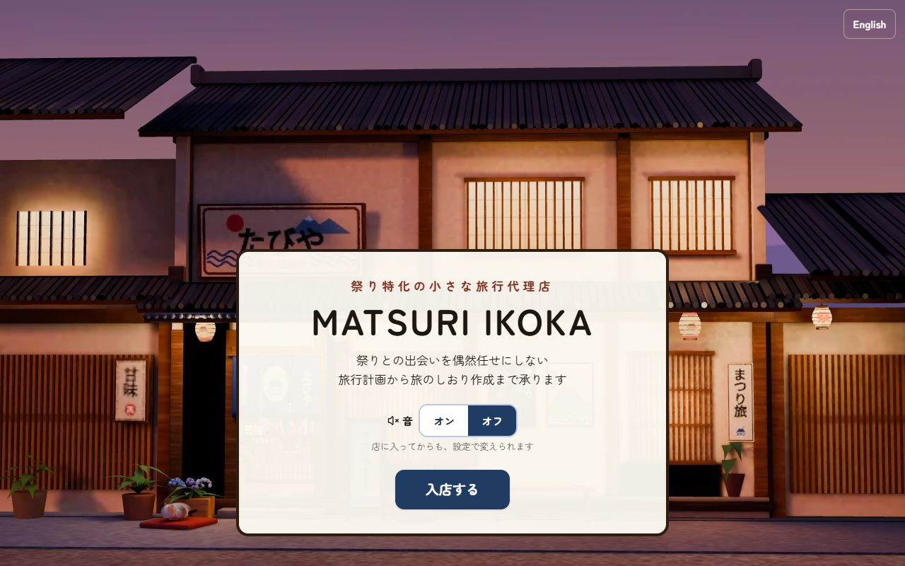
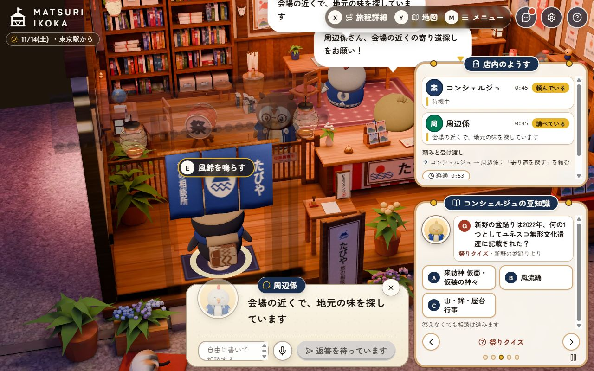
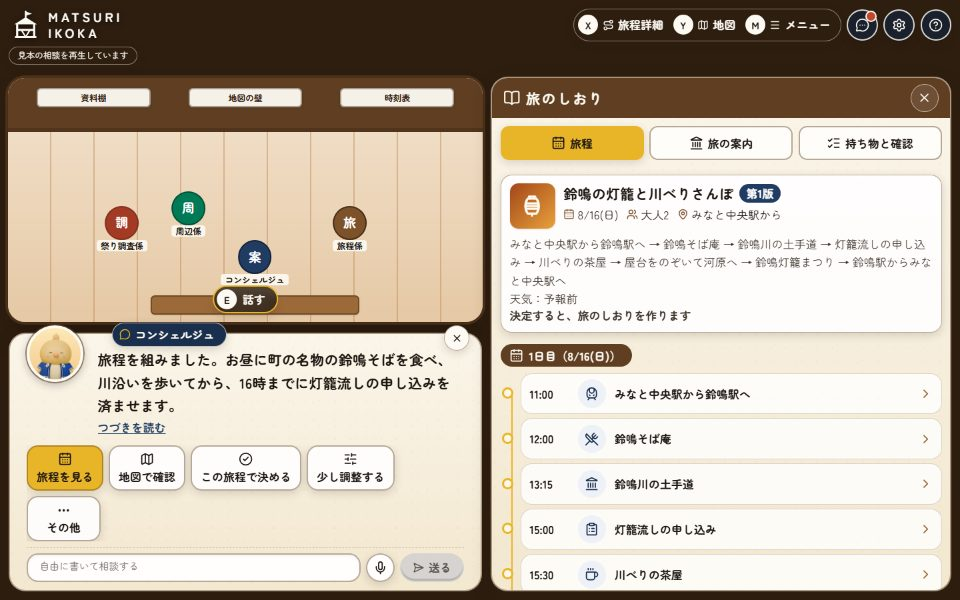
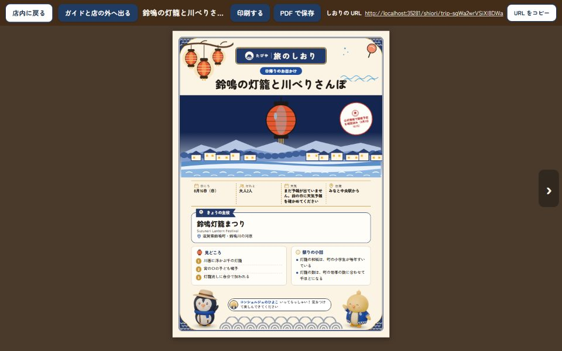
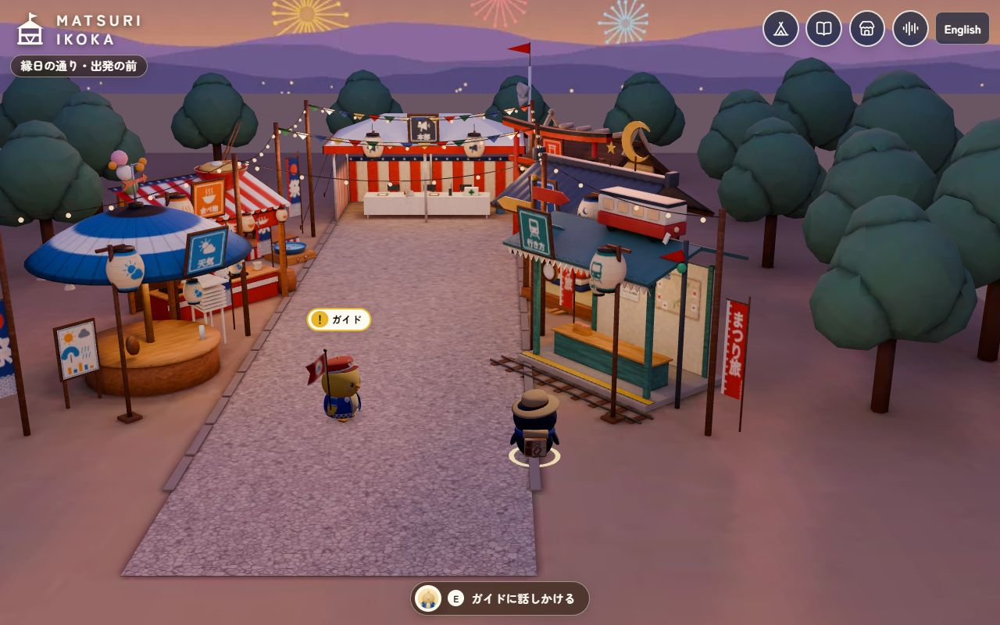
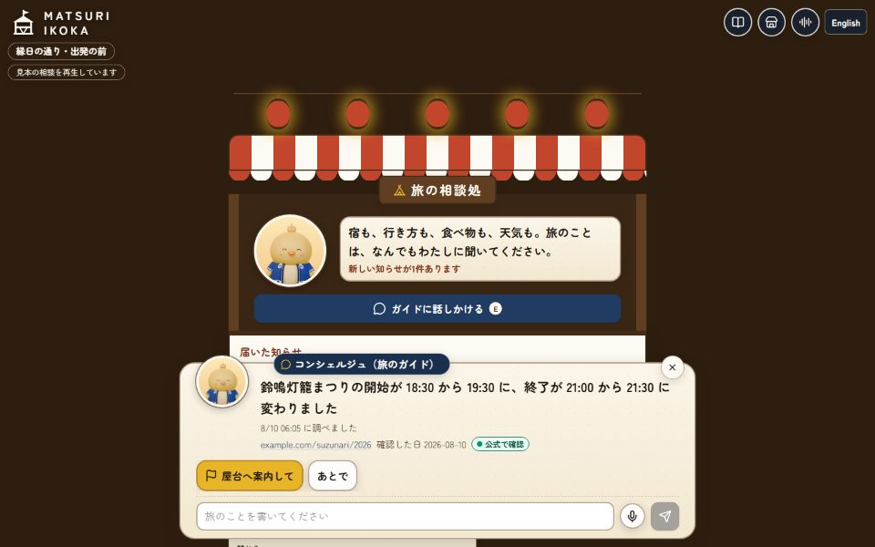
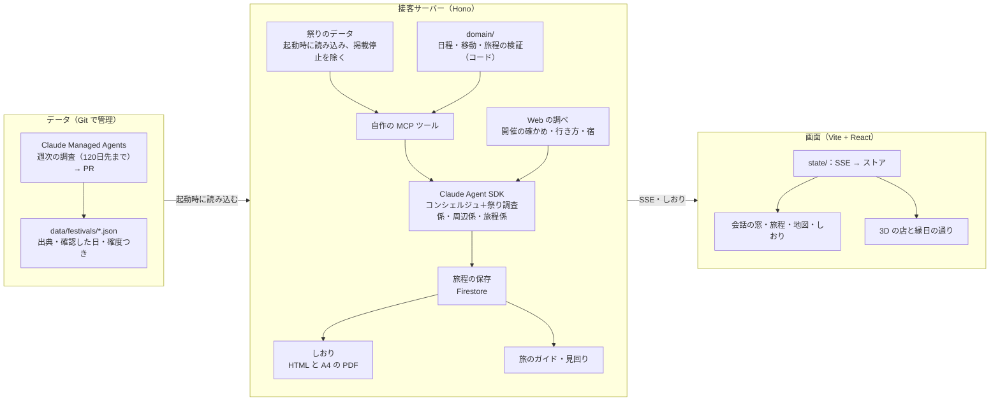

<h1 align="center">MATSURI IKOKA</h1>

<p align="center">
  <b>偶然任せにしない、祭りとの出会いを。</b><br>
  <i>祭り、行こか？ — Shall we go to a matsuri?</i><br>
  旅の計画に、その土地の祭りを組み込む AI の旅行代理店
</p>

<p align="center">
  <a href="https://matsuri-ikoka-v7vvs3ze4a-an.a.run.app"><b>公開している URL で使う</b></a>
  &nbsp;·&nbsp;
  <a href="#ローカルで動かす">手元で動かす</a>
  &nbsp;·&nbsp;
  <a href="#できること">できること</a>
  &nbsp;·&nbsp;
  <a href="#仕組み">仕組み</a>
  &nbsp;·&nbsp;
  <a href="docs/spec/README.md">仕様</a>
</p>

<p align="center">
  <a href="https://github.com/kdoai/matsuri-ikoka/actions/workflows/ci.yml"></a>
  <a href="https://github.com/kdoai/matsuri-ikoka/actions/workflows/deploy.yml"></a>
  <a href="LICENSE"></a>
</p>

<p align="center">
  
</p>

日付・出発する駅・泊数と、「ご当地の味も楽しみたい」のようなひとことを伝えるだけで、「祭り」と言わなくても、その日その地域で開かれる祭りを AI が探し、開催を公式の情報で裏どりしてから旅程に差し込みます。検索ではなく提案なので、名前を知らない祭りとも出会えます。旅程はそのまま「旅のしおり」になり、しおりを受け取ったあとも、旅の終わりまで専属のガイドが付き添います。

| 数字で見る                                                                                                                                  |
| ------------------------------------------------------------------------------------------------------------------------------------------- |
| 出典つきの祭り **244 件**。うち大手の観光サイトにほとんど載っていない穴場が **45%**                                                         |
| 相談でよくある条件の組 **480 通り**を検索に流し、**83%** で候補を出せた。条件を破った候補は **0 件**                                        |
| Claude を **3つの形**で使い分ける：開発の Claude Code、接客の Agent SDK（コンシェルジュ＋スタッフ3人）、週次の調査と見回りの Managed Agents |

<sub>数字は基準の日 2026-11-06 の集計。出し直し方は[評価](docs/evaluation.md)にあります。</sub>

## 目次

- [なぜ作るのか](#なぜ作るのか)
- [旅の流れ](#旅の流れ)
- [使ってみる](#使ってみる)
- [できること](#できること)
- [できないこと](#できないこと)
- [個人情報の扱い](#個人情報の扱い)
- [仕組み](#仕組み)
- [Claude の使い方](#claude-の使い方)
- [評価](#評価)
- [開発](#開発)
- [ライセンス](#ライセンス)

## なぜ作るのか

祭りもご当地の味も、その土地でしか知られていない宝物が日本中にあります。けれど、担い手が減り、途絶えたり休んだりする祭りが出はじめています。外から来る人が加わることは、祭りを続ける力になります。それでも、外の人は祭りに出会えません。

- 祭りだけを目的に旅をする人は少ない
- 名前を知らない祭りは、検索できない
- 開催日は、わざわざ自分から調べないと分からない。開催の時期や時間が変わることも増えている

だから MATSURI IKOKA は、祭りを探しに来た人ではなく、**旅を計画しに来た人**に祭りを届けます。旅のついででいい。その土地に来たなら、その土地の祭りに足を運べるように、行く人の前にある**情報と計画**の2つの壁を取り除きます。

<table>
  <tr>
    <th align="left" width="64">壁</th>
    <th align="left">行く人の困りごと</th>
    <th align="left">MATSURI IKOKA がすること</th>
  </tr>
  <tr>
    <td><b>情報</b></td>
    <td>名前を知らない祭りは探せない。小さな町の祭りは検索の上位に出ない。見つけても、今年の日時が確かか分からない</td>
    <td>「祭り」と言われなくても、旅の日付と地域から祭りを探して提案する。候補を見せる前に公式の情報で開催を裏どりする</td>
  </tr>
  <tr>
    <td><b>計画</b></td>
    <td>祭りの時間は動かせない。そこから逆算して移動・食事・休憩・帰りの混雑まで組むのは手間</td>
    <td>祭りの時間を先に固定し、移動・食事・宿・天気のそろった時刻つきの旅程をコードで検証して組む</td>
  </tr>
</table>

祭りは一期一会です。間違った日時を伝えれば、その出会いは失われます。だから、提案の前と旅程の確定の前に開催を確かめ、出典の分からない情報は使いません。祭りの側に手間をかけずに、祭りと外の人を「つなぐ役」を担います（[課題](docs/problem.md)）。

## 旅の流れ

<table>
  <tr>
    <th align="center">1</th>
    <th align="center">2</th>
    <th align="center">3</th>
    <th align="center">4</th>
    <th align="center">5</th>
  </tr>
  <tr>
    <td align="center"><b>店に入る</b></td>
    <td align="center"><b>相談する</b></td>
    <td align="center"><b>旅程を組む</b></td>
    <td align="center"><b>しおりを持つ</b></td>
    <td align="center"><b>ガイドと出かける</b></td>
  </tr>
  <tr>
    <td>3D の店で、旅人のペンギンを歩かせてコンシェルジュに話しかける</td>
    <td>「旅行計画から探す」なら、日付・出発する駅・泊数とひとことを伝えるだけ。スタッフがその日その地域の祭りを調べ、開催を裏どりした候補を最大3つ出す。行きたい祭りを探したいときは「祭りから探す」</td>
    <td>祭りの時間を軸に、移動・食事・宿・天気のそろった旅程ができる。こだわりや会話で直せる</td>
    <td>確定の前にもう一度開催を確かめ、画面と A4（HTML・PDF）のしおりにする</td>
    <td>店の外の 3D の縁日の通りで、旅のことをいつでも旅のガイドに相談する。留守の間の変化は見回りが知らせ、組み直しを提案する</td>
  </tr>
</table>

<table>
  <tr>
    <td align="center" width="50%">
      <br>
      <sub>店の外観から「入店する」</sub>
    </td>
    <td align="center" width="50%">
      <br>
      <sub>3D の店内で相談する。スタッフの頼みと受け渡しが文字でも読め、待ち時間には祭りのクイズが出る</sub>
    </td>
  </tr>
  <tr>
    <td align="center">
      <br>
      <sub>祭りの時間を軸にした、時刻つきの旅程。天気の予報も添える</sub>
    </td>
    <td align="center">
      <br>
      <sub>確定の前に開催を確かめ直して、旅のしおりに。印刷と PDF、共有の URL</sub>
    </td>
  </tr>
  <tr>
    <td align="center">
      <br>
      <sub>しおりのあとは店の外の 3D の縁日の通りへ。天気・食べ物・行き方の屋台が並ぶ</sub>
    </td>
    <td align="center">
      <br>
      <sub>旅のガイドは、出典と確認した日・確度つきで答える</sub>
    </td>
  </tr>
</table>

<p align="center"><sub>画像は、手元で Claude と実際の祭りのデータを使って相談したときのものです</sub></p>

## 使ってみる

### 公開している URL

**https://matsuri-ikoka-v7vvs3ze4a-an.a.run.app**

「入店する」を押すと店に入れます。コンシェルジュに話しかけて、「旅行計画から探す」か「祭りから探す」を選ぶと相談が始まります。合言葉を設定している環境では、入店の前に合言葉を聞きます。合言葉は、URL を知らせた人から受け取ってください。合言葉がなくても、下の「ローカルで動かす」の手順なら合言葉なしで試せます。合言葉は端末に残さない（メモリにだけ持つ）ので、再読み込みや別のタブでは入れ直します。ログインのボタンは、ログインを用意している環境でだけ出ます。

### ローカルで動かす

必要なもの：Node.js 22.12 以上（24 を推奨）、pnpm 10

```bash
git clone https://github.com/kdoai/matsuri-ikoka.git
cd matsuri-ikoka
pnpm install
pnpm dev
```

`pnpm dev` で、画面（http://localhost:5173 ）と接客サーバー（http://localhost:8787 ）が一緒に立ち上がります。画面はいつも接客サーバーと話します（Vite が `/api` と `/shiori` を中継します）。

<details>
<summary>ポートがふさがっているとき</summary>

どちらかのポートがふさがっていると、別のポートへずらさずに止まります。別の `pnpm dev` を止めるか、`PORT=8788 MATSURI_WEB_PORT=5174 pnpm dev` のようにポートを変えて起動してください（画面は `PORT` の接客サーバーへ中継します）。

</details>

#### Claude と話す

[`.env.example`](.env.example) をリポジトリのルートに `.env` としてコピーし、値を入れて起動します。`pnpm dev` と `check:live` は、ルートの `.env` があれば読みます（`.env` は Git の対象外）。シェルで渡した環境変数は `.env` より優先します。

```bash
MATSURI_AGENT_MODE=live MODEL_CONCIERGE=<モデル名> MODEL_STAFF=<モデル名> pnpm dev
```

| 変数                                                                   | 中身                                                                                                                                                       |
| ---------------------------------------------------------------------- | ---------------------------------------------------------------------------------------------------------------------------------------------------------- |
| `MATSURI_AGENT_MODE`                                                   | `live` にする                                                                                                                                              |
| `ANTHROPIC_API_KEY`                                                    | Claude の API キー。Claude Code にログイン済みの手元の環境では、空のままでも動く                                                                           |
| `MODEL_CONCIERGE`・`MODEL_STAFF`                                       | コンシェルジュと、スタッフ（祭り調査係・周辺係）と、候補を出す前の開催の確かめのモデル名                                                                   |
| `MODEL_PLANNER`・`MODEL_EVALUATOR`                                     | 旅程係と、旅程の評価係のモデル名。省略すると旅程係は `MODEL_STAFF`、評価係は旅程係と同じ。強いモデルを勧める                                               |
| `MODEL_VERIFIER`                                                       | 確定前の再確認のモデル名。省略すると `MODEL_STAFF`                                                                                                         |
| `MODEL_GUIDE`                                                          | しおりのあとの旅のガイドのモデル名。省略すると `MODEL_CONCIERGE`。どちらも空なら、ガイドだけが使えず、店内の相談は動く                                     |
| `MODEL_WISH_READER`                                                    | 祭りから探すときの、自由記述の読み取り。省略すると軽いモデル                                                                                               |
| `AGENT_MAX_BUDGET_USD`                                                 | 1回の発言の費用の上限（米ドル）。省略すると上限なし                                                                                                        |
| `MATSURI_FESTIVALS_DIR`                                                | 祭りのデータを読む場所。省略すると、live は `data/festivals`、モックは架空の祭り                                                                           |
| `ACCESS_PASSCODE`                                                      | 合言葉。設定すると、`/api` を呼ぶたびに合言葉を確かめる。手元では空のままでよい                                                                            |
| `MATSURI_STORAGE`                                                      | 旅程の置き場所。`memory`（既定。再起動で消える）か `firestore`                                                                                             |
| `RAKUTEN_APPLICATION_ID`・`RAKUTEN_ACCESS_KEY`・`RAKUTEN_ALLOWED_SITE` | 宿の空きと料金を調べる楽天トラベルの API（ID とキーの両方がそろうと使う）。なければ、本番は実在の宿を Web で調べ（空きは調べない）、手元は見本の宿で試せる |

役割ごとの勧める値と、宿の空き・ログイン・見回りなどの変数は、[`.env.example`](.env.example) と[環境変数の一覧](docs/spec/operations.md#環境変数)にあります。

祭りのデータは [`data/festivals/`](data/festivals) から読み込みます。実際に Claude を呼んで、相談が最後まで通るかを確かめるには、`check:live` を使います。段階ごとに OK / NG を出し、最後にかかった時間と費用（SDK の推定）の合計を出します。CI では走りません。

```bash
pnpm --filter @matsuri-ikoka/server check:live                # 祭りの候補まで
pnpm --filter @matsuri-ikoka/server check:live -- --itinerary # 祭りを選んで、旅程の保存まで
pnpm --filter @matsuri-ikoka/server check:live -- --shiori    # 決定・確定前の再確認・しおり（HTML と PDF）まで
```

<details>
<summary>実在の祭りのデータで、好きな発言を流す</summary>

ここまでは架空の祭り（[`data/samples/festivals/`](data/samples/festivals)）を、開催日を今日の2週間後にずらして使います。架空の祭りの出典は Web で読めないので、確定前の再確認は、データの公式の出典を読んだとみなす代わりの口で行います（候補の確かめは行いません）。

実在の祭りのデータに好きな発言を流すときは、`--festivals` と `--say` を渡します。候補の確かめと確定前の再確認は、本物と同じく Web で行います。`--itinerary` を付けると旅程の保存まで、`--no-pdf` を付けると PDF を取りません。PDF には Chromium が要ります（`pnpm --filter @matsuri-ikoka/web exec playwright install chromium`）。

```bash
pnpm --filter @matsuri-ikoka/server check:live -- --festivals "$PWD/data/festivals" \
  --say "<日付>に、<駅>から日帰りで、大人2人で行ける祭りはありますか。" \
  --say "<祭りの名前>にします。" --say "この旅程で決定します。"
```

</details>

#### ログインと保存

何も設定しなければ、旅程はサーバーのメモリに置き（再起動で消えます）、ログインは出ません。ログインと保存を手元で試すときは、Firestore と Auth のエミュレーターを使います（[ログインと保存の仕様](docs/spec/account.md#手元で動かす)）。

## できること

### 情報の壁を取り除く

- **「祭り」と言わなくても、旅に祭りを差し込む**：日帰りのお出かけから6泊7日まで相談できます。探し始めるのに要るのは、日付（1日か期間）・出発する駅・泊数の3つだけです。3泊以上の旅では、旅のかたち（一か所に泊まる・いくつかの地域を巡る・目的地へ向かう途中で寄る）と回りたい地域を、探す前に聞きます。1回に聞くのは2つまでで、「おまかせ」と言えばそれ以上は聞きません。条件に合う祭りを、大手の観光サイトに載っていない祭りも含めて、最大3つ提案します
- **祭りから探す**：行きたい祭りがまだ分からないときは、種類・季節・地域と自由な希望から祭りを探し、最大6件を見比べられます。決めた祭りは、そのまま情報を見て終えることも、必ず行く祭りとして旅程にすることもできます
- **提案の前に、開催を確かめる**：候補を見せる前に、開催日・時刻・状態（予定どおり・変更・中止）を公式の情報で確かめ、その結果を候補のカードに付けます。中止と分かった祭りはすすめません。旅程を確定する前にも、もう一度確かめます
- **確かさが分かる**：祭りの情報には必ず出典と確度（公式で確認・複数で確認・要確認・推定）が付きます。分からないことは推測で埋めず、「分からない」と書きます
- **120日先までの祭りを調べ続ける**：Claude Managed Agents が週に1回、120日先までに開かれる祭りを、開催日の近いものから順に公式の情報で調べ直します。情報源で裏どりできたものだけを残すので、開催の時期や時間の変更にも追いつけます。祭りのデータには項目ごとに最後に確かめた日があり、取り込める結果は PR で届け、人が見てからマージします

### 計画の壁を取り除く

- **行ける旅程にする**：祭りの時間を先に固定し、行き方（乗り換えと帰りの最終）・食事・休憩・寄り道・天気・帰りの混雑の避け方までを組みます。営業時間の外の予定や祭りと重なる予定は、コードの検証で受け付けません。保存のたびに評価係が見て、基準に届かなければ調べ直して作り直します
- **泊まりの旅は1日ずつ**：画面の旅程が1日ずつ増えていきます。泊まりには、会場の近くの宿の候補を、距離や料金の目安と出典つきで添えます（宿泊予約の API か、Web で調べた結果だけを使います）
- **天気も添える**：気象庁の予報から、旅の日ごとの天気を付けます。予報の範囲の外は「予報前」と書きます
- **こだわりを切り替える**：同行者・場所の好み・ごはん・移動の4つのこだわりを切り替えられ、会話で直せます
- **しおりを持って出かける**：公式の情報で開催を確かめた旅程は、しおりになります。画面の中で読んで印刷でき、共有の URL を開けば、A4 のしおりを HTML で読んだり、PDF で保存・印刷したりできます。A4 のしおりには、表紙・祭りの紹介・日ごとの流れ・持ち物のチェックリスト・スタンプ帳・出典が入ります

### 旅の終わりまで付き添う

- **縁日の通りでガイドに相談する**：しおりのあとは店の外の縁日の通りへ出て、宿・行き方・食べ物・天気・雨のときの案を、旅の終わりまでガイドに相談できます。当日の遅れ・迷子・忘れ物にも、残りの予定を提案します。体調や事故のときは診断も判断もせず、返事の最初で公的な番号（119・110）への電話を勧めます
- **留守の間の変化を見回る**：ログインして旅を残し、見回りを頼むと、公式のページの開催の変更・中止・お知らせと、宿の空きを定期的に確かめます。変化は出典と調べた時刻つきの通知にし、次に開いたときに屋台の提灯で知らせます。中止と日程の変更は、公式か2つ以上の情報源で一致したときだけ知らせます。天気の変化はまだ見回りません
- **組み直しは承認してから**：変化に合わせた直しの案は、今の旅程と同じ検証と評価に通してから見せます。承認するまで旅程は変わらず、承認したあとでも前の版に戻せます

### 遊べる店で、声でも

- **3D の店で相談する**：旅人のペンギンを、キーボード・ゲームパッド・タップで歩かせ、コンシェルジュに話しかけて相談します。店のあちこちの仕掛けを動かしたり、席に座ったり、隠れているひよこを探したりもできます。スタッフは、調べものに合わせて持ち場へ動きます。同じことを文字でも読め、動きを減らす設定のときは 3D のまま動きを控えめにします
- **声で話す**：会話の窓の返事を読み上げ、マイクのボタンを押している間だけ声で入力できます。ブラウザの機能だけを使い、音声はこのアプリに送りません。聞き取った文は、送る前に確かめて直せます
- **待ち時間も楽しい**：返事を待つ間は、コンシェルジュが、祭りの小話や見どころを出典つきで話します。長く待ちそうなときは、祭りのクイズが出ます
- **旅を残す**：メールアドレスとパスワード、または Google でログインすると、組んだ旅を残して、あとで開いたり、家族や友だちにしおりを共有したりできます。相談はログインしなくても始められます
- **日本語と英語**：画面の言葉を切り替えられます

## できないこと

- 宿・交通・祭りの予約や支払い
- 祭りの主催者による登録や編集の画面
- 会話の履歴を残して、あとから読み返すこと（残すのは旅程と、相談の続きに要る条件、ガイドの手帳と通知だけです）
- アプリの外への通知（メールやプッシュ通知）。見回りの結果は、次に開いたときに届けます
- 体調や事故の診断と判断
- 当日の開催の保証。**出かける前に、必ず公式サイトで最終確認をしてください**

## 個人情報の扱い

- 出発地は駅名までにとどめ、住所は聞きません
- 会話の全文は、ログにも旅程の保存先にも残しません。相談を続けるために、聞き取った条件・こだわり・旅程の ID・相談の段階だけを残します。旅程のない相談は6時間で、旅程を持つ相談は旅程と同じ期限で消します。Claude との会話の記録は、相談を続ける間だけサーバーの一時的な場所に置き、相談が消えるときに消します
- 声の入力と読み上げはブラウザの機能で、このアプリは音声を受け取らず保存もしません。ブラウザによっては、声を文字にするためにブラウザの提供元のサーバーへ送ることがあるので、使う前に説明を出します
- ログインは、旅を残す・あとで開く・消す・見回りを頼むときだけ使います（メールアドレスとパスワード、または Google でのログイン）。ログインの記録にはメールアドレスと、Google でログインした人はアカウントの名前が入ります。パスワードは Firebase Authentication が預かり、このアプリは持ちません。旅の保存先には、利用者を見分ける ID だけを置きます
- 見回りは、頼まれた旅だけを対象にします。見回り係には利用者の情報も権限も渡しません
- ログインせずに作った旅程と、共有したしおりは、最後の保存から30日と、旅の最終日の3日後の遅いほうで、自動的に消します。ログインして残した旅は、ご自身で消すまで残ります
- 残した旅は、自分の旅の一覧から1つずつ消せます（ガイドの手帳・通知・提案・見回りの依頼もいっしょに消えます）。「旅とログインの記録をすべて消す」を押すと、残した旅・共有したしおり・このアプリのログインの記録をすべて消します
- 旅は、ご本人のほかは読めません。しおりの共有の URL を知っている人だけが、そのしおりを開けます

くわしくは[運用と安全の仕様](docs/spec/operations.md#個人情報)と[ログインと保存の仕様](docs/spec/account.md)にあります。

## 仕組み



<table>
  <tr>
    <th align="left" width="160">部分</th>
    <th align="left">どう動くか</th>
  </tr>
  <tr>
    <td><b>接客</b></td>
    <td>Claude Agent SDK のマルチエージェントで役割を分担します。客と話すコンシェルジュと、裏で調べる3人のスタッフ（祭り調査係・周辺係・旅程係。サブエージェント）が受け持ちます。スタッフが使えるのは、プロセス内の MCP サーバーの自作のツールだけです。接客のエージェントは開発環境の設定を読まず、ファイルやシェルの道具を持ちません</td>
  </tr>
  <tr>
    <td><b>コードと Claude の分担</b></td>
    <td>日程のルール・移動時間・営業時間・旅程の検証・聞き取りの順番はコードで決めます。Claude は希望の読み解き・祭りの選定・旅程の組み合わせ・文章を受け持ちます。旅程は保存のたびに評価係（道具を持たない1回きりの呼び出し）が見ます</td>
  </tr>
  <tr>
    <td><b>Web の調べ</b></td>
    <td>候補を出す前と確定の前の開催の確かめ、行き方・寄り道・宿の調べは、Web の検索と取得だけを許した1回きりの呼び出しで行い、読んだページにある出典だけを使って結果を返します。スタッフには Web を渡しません</td>
  </tr>
  <tr>
    <td><b>旅のガイド</b></td>
    <td>しおりのあとの相談は、旅程を読む・通知を読む・Web や天気や行き方を調べる・直しを提案する・手帳に残すツールだけで動きます。提案は承認されるまで旅程を変えません。見回りは、変化のあったページだけを別のワークスペースの Managed Agents に読ませ、報告をコードで検問してから通知にします</td>
  </tr>
  <tr>
    <td><b>画面</b></td>
    <td>Vite + React。SSE のイベントをストアに変え、3D（React Three Fiber）の店と縁日の通り、会話の窓が同じストアを読みます。3D に出す情報は、すべて文字でも読めます</td>
  </tr>
  <tr>
    <td><b>しおり</b></td>
    <td>接客サーバーが HTML を作り、同じテンプレートから Chromium で A4 の PDF にします</td>
  </tr>
  <tr>
    <td><b>データ</b></td>
    <td>祭りのデータは1件1ファイルの JSON で、Git と CI の検証で管理します。週に1回の調査は Managed Agents の定期実行が行い、GitHub Actions が準備と回収をして PR にします。旅程と共有は Firestore（設定しなければメモリ）、ログインは Firebase Authentication です</td>
  </tr>
  <tr>
    <td><b>公開</b></td>
    <td>main に入った変更を、GitHub Actions が Cloud Run に出します。イメージを Claude を呼ばずに動かして確かめ、新しい版を通信なしで置いて外から確かめてから、通信を切り替えます</td>
  </tr>
</table>

くわしくは次の文書にあります。

| 文書                                        | 中身                                                                |
| ------------------------------------------- | ------------------------------------------------------------------- |
| [課題](docs/problem.md)                     | 行く人の壁と、つなぐ役として何をするか                              |
| [アーキテクチャ](docs/architecture.md)      | 全体の図、相談1回の流れ、設計の原則、エージェントの切り離し         |
| [アプリの仕様](docs/spec/README.md)         | データ・API・エージェント・旅程・画面・しおり・ガイド・運用と安全   |
| [設計判断の記録（ADR）](docs/adr/README.md) | Agent SDK、データの持ち方、3D、ログイン、宿、週次の調査、見回りなど |
| [評価](docs/evaluation.md)                  | 何を測り、何を測っていないか                                        |
| [開発の流れ](docs/development.md)           | Issue からデプロイまで、CI のジョブ、Claude Code のスキル           |

## Claude の使い方

開発・製品・運用の3つを同じ Claude で回し、場面ごとに使う形を分けています。

<table>
  <tr>
    <th align="left" width="120">場面</th>
    <th align="left" width="200">使う形</th>
    <th align="left">何をするか</th>
  </tr>
  <tr>
    <td><b>開発</b></td>
    <td>Claude Code（Claude Desktop）</td>
    <td>Issue の起票・コミット・PR・見直し・リリースノートまでの各段を、このリポジトリの決まりをスキルにして任せます。祭りのデータの調査と検品も同じ Claude Code で行います。<code>resolve-issue</code> スキルは Issue を1件選び、専用の worktree で直して PR にし、CI が通ったらマージするところまでを、人がいなくても進められる形にしてあります</td>
  </tr>
  <tr>
    <td><b>製品（接客）</b></td>
    <td>Claude Agent SDK</td>
    <td>コンシェルジュと3人のスタッフ（サブエージェント）のマルチエージェント。使える道具はプロセス内の MCP サーバーの自作のツールだけで、ファイルやシェルは渡しません。開発用の設定・スキル・<code>CLAUDE.md</code> は読まず、コンテナにも入れません</td>
  </tr>
  <tr>
    <td><b>運用</b></td>
    <td>Claude Managed Agents</td>
    <td>祭りのデータの週次の調査（<a href="managed-agents/">managed-agents/</a>）と、頼まれた旅の見回り（<a href="managed-agents-patrol/">managed-agents-patrol/</a>）。定期実行で動き、結果はコードが検査してから PR や通知にします。調査員には、開発で使う <code>festival-research</code> スキルだけを渡します</td>
  </tr>
</table>

Claude の機能も、目的ごとに使い分けています。

<table>
  <tr>
    <th align="left" width="200">機能</th>
    <th align="left" width="200">目的</th>
    <th align="left">このリポジトリでの中身</th>
  </tr>
  <tr>
    <td>スキル<br><sub><a href=".claude/skills/">.claude/skills/</a></sub></td>
    <td>手順と決まりを渡す</td>
    <td>開発の各段の <code>commit</code>・<code>create-issue</code>・<code>create-pr</code>・<code>review-pr</code>・<code>resolve-issue</code>・<code>release-notes</code>・<code>setup-github-repo</code>、祭りの調査の <code>festival-research</code>、しおりの作り直しの <code>shiori</code></td>
  </tr>
  <tr>
    <td>サブエージェント<br><sub><a href=".claude/agents/">.claude/agents/</a>、<a href="apps/server/src/agent/">apps/server/src/agent/</a></sub></td>
    <td>別の目で見る、役割を分ける</td>
    <td>開発では <code>data-auditor</code> が、祭りのデータの出典・確度・推測の混入・確認日の古さを、ファイルを書き換えずに検品して報告します。製品では祭り調査係・周辺係・旅程係が、それぞれに許したツールだけで調べます</td>
  </tr>
  <tr>
    <td>MCP ツール<br><sub><a href="apps/server/src/tools/">apps/server/src/tools/</a></sub></td>
    <td>判断は Claude、計算はコード</td>
    <td>祭りの検索・開催の確かめ・行き方・天気・宿・旅程の保存など、接客に10個・ガイドに8個の自作ツール。絞り込みと検証をコードで行い、結果だけを Claude に返します</td>
  </tr>
  <tr>
    <td>フック<br><sub><a href="apps/server/src/agent/hooks.ts">apps/server/src/agent/hooks.ts</a>、<a href=".claude/hooks/">.claude/hooks/</a></sub></td>
    <td>ツールの前後を画面に伝える、決まりを守らせる</td>
    <td>製品では、ツールの前後で SSE のイベントを出し、画面のスタッフと吹き出しを動かします。スタッフと道具の組み合わせや、スタッフを呼ぶ回数もここで守ります。開発では、祭りのデータを書き換えたら <code>pnpm validate:data</code> を自動で走らせ、スキーマや出典の決まりに合わないデータをその場で Claude に知らせます。会話が英語に寄ったら、日本語で書き直させます（文書・コミット・PR をそろえるため）</td>
  </tr>
  <tr>
    <td>権限の設定<br><sub><a href=".claude/settings.json">.claude/settings.json</a></sub></td>
    <td>読ませないものを決める</td>
    <td><code>.env</code> の読み取りを共有の設定で拒否します</td>
  </tr>
</table>

Issue からデプロイ、祭りのデータの週次の更新までの流れと CI のジョブは[開発の流れ](docs/development.md)、開発用のものとアプリを分ける決まりは[同じ文書の「開発用のものとアプリを分ける」](docs/development.md#開発用のものとアプリを分ける)にあります。

## 評価

祭りのデータについて、次の開催を公式で確認できた割合や、穴場の祭りの割合を測っています。また、相談でよくある条件の組を祭りの検索に流し、候補を出せた割合と、条件を破った候補がないことを確かめています。どれも `pnpm evaluate:data` と `pnpm evaluate:conditions` で出し直せます。旅程の検証で落ちた割合は、Claude を呼ばないと測れないので、まだ測っていません。測り方・結果・測っていないことは[評価](docs/evaluation.md)にあります。

## 開発

| コマンド             | 中身                                                           |
| -------------------- | -------------------------------------------------------------- |
| `pnpm dev`           | 画面と接客サーバーを開発モードで起動する                       |
| `pnpm lint`          | Biome で lint と format を確かめる（直すときは `pnpm format`） |
| `pnpm typecheck`     | すべてのパッケージの型を確かめる                               |
| `pnpm test`          | Vitest ですべてのテストを走らせる                              |
| `pnpm validate:data` | 祭りのデータを検証する                                         |
| `pnpm build`         | 画面と接客サーバーをビルドする                                 |

画面の通しテスト（Playwright）は `pnpm --filter @matsuri-ikoka/web test:e2e` で走り、記録した架空の相談を流して、相談からしおり・縁日の通りまでを通します（CI では手で起動したときだけ走ります）。CI では、上のコマンドに加えて、コンテナを動かす確かめ・秘密情報の検出・CodeQL が走ります。

開発の始め方とコミットの書き方は [CONTRIBUTING.md](CONTRIBUTING.md)、Issue からデプロイまでの流れは[開発の流れ](docs/development.md)、Claude Code で開発するときの決まりは [CLAUDE.md](CLAUDE.md)、脆弱性の報告は [SECURITY.md](SECURITY.md) にあります。

## ライセンス

[MIT](LICENSE)。ただし、次のものは元の条件に従います。

| 場所                                              | 中身                                     | 条件                                                                                       |
| ------------------------------------------------- | ---------------------------------------- | ------------------------------------------------------------------------------------------ |
| [`data/places/`](data/places/README.md)           | OpenStreetMap から抜き出した店と宿の一覧 | [ODbL 1.0](https://opendatacommons.org/licenses/odbl/1-0/)（© OpenStreetMap contributors） |
| [`assets/shiori/fonts/`](assets/shiori/README.md) | Zen Maru Gothic                          | [SIL Open Font License 1.1](assets/shiori/fonts/OFL.txt)                                   |

BGM（[`assets/audio/`](assets/audio/README.md)）は Suno の Pro プランで作った曲で、権利はこのリポジトリの作者が持ち、MIT で公開します。
