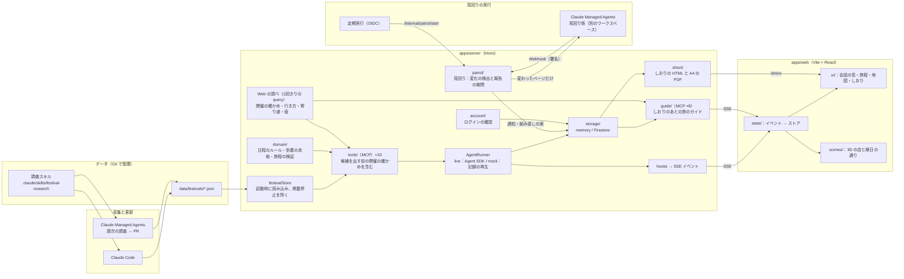
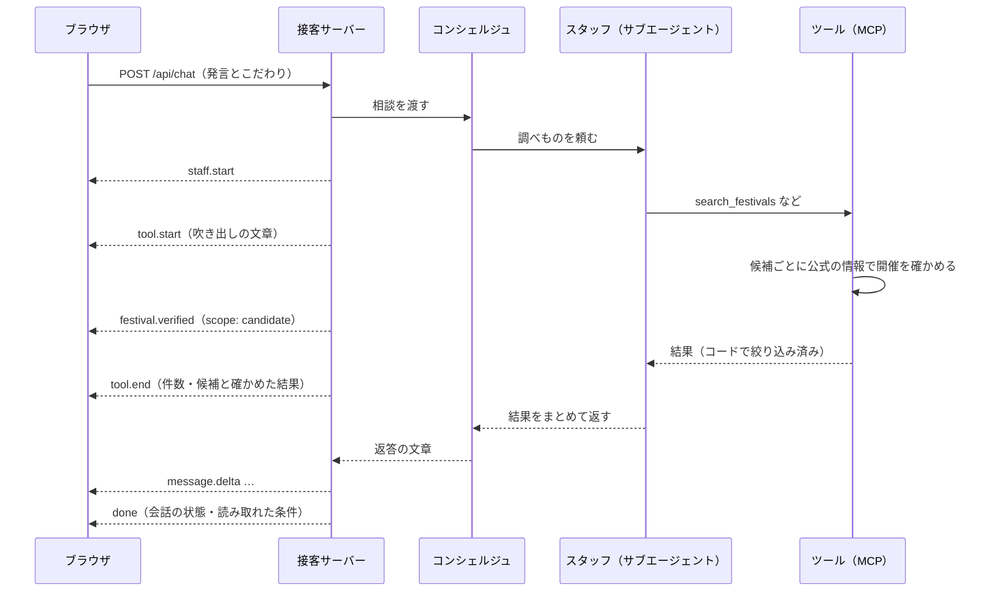

# アーキテクチャ

MATSURI IKOKA は「データの保守」「相談」「旅の付き添い」の3つに分かれます。祭りのデータは Git で管理する JSON ファイルで、相談と、しおりのあとのガイドと見回りは、そのデータを読み込んだ1つのサーバーが受け持ちます。

## 全体の図



## 構成要素

| 構成要素         | 役割                                                                                                                                                                                            | 技術                                                                           |
| ---------------- | ----------------------------------------------------------------------------------------------------------------------------------------------------------------------------------------------- | ------------------------------------------------------------------------------ |
| ブラウザ         | 3D の店内、こだわり、会話、旅程・地図・出典、しおり                                                                                                                                             | React、React Three Fiber、Leaflet、Tailwind CSS                                |
| 接客サーバー     | 画面の配信、相談の API、SSE、合言葉と回数の上限、しおりの HTML と A4 の PDF                                                                                                                     | Node、Hono、Playwright（Chromium）                                             |
| 接客エージェント | コンシェルジュと、裏で調べる3人のスタッフ（サブエージェント）                                                                                                                                   | Claude Agent SDK（TypeScript）                                                 |
| 旅のガイド       | しおりのあと、旅の終わりまでの相談。旅程と通知を読み、Web・天気・行き方を調べ、直しを提案し、手帳に残す。提案は承認されるまで旅程を変えない（[旅のガイド](spec/guide.md)）                      | Claude Agent SDK（TypeScript）、専用の MCP サーバー（8つのツール）             |
| 見回り           | 頼まれた旅の公式のページと宿の空きを定期的に確かめ、変化を通知と組み直しの案にする。変わったページだけを見回り係に読ませ、報告はコードで検問する（[旅の見回り](spec/operations.md#旅の見回り)） | `patrol/`、Claude Managed Agents（別のワークスペース）、OIDC と Webhook の署名 |
| カスタムツール   | 接客に10、ガイドに8のツール。日程のルールや検証はここでコードとして実行する                                                                                                                     | プロセス内の MCP サーバー、Zod                                                 |
| 祭りのデータ     | 1件1ファイルの JSON。コンテナに同梱し、起動時にメモリへ読み込む                                                                                                                                 | JSON、Zod                                                                      |
| 旅程の保存       | 旅程の版・しおりの共有・相談の途中の状態を残す。サーバーだけが読み書きする（[ログインと保存](spec/account.md)）                                                                                 | 既定はメモリ、`MATSURI_STORAGE=firestore` で Firestore（Admin SDK）            |
| ログイン         | 旅を残す・あとで開く・消すときだけ。相談はログインなしで始められる                                                                                                                              | Firebase Authentication（Google、メールアドレスとパスワード）                  |
| データの更新     | 祭りの調査と追加は、調査スキルを使って手元の Claude Code で行い、PR で取り込む。開催情報の週次の調査は Managed Agents の定期実行で進め、GitHub Actions が準備と回収を行い、結果を PR で届ける   | Claude Code、Claude Managed Agents、GitHub Actions                             |
| スキーマ         | データ・旅程・SSE イベントの型の唯一の定義                                                                                                                                                      | `packages/schema`（Zod）                                                       |

## 相談1回の流れ

利用者の発言1つに、SSE の接続を1本使って返します。スタッフが調べている途中でも、フックから出たイベントが届くので、画面は待ち時間にも動き続けます。



イベントの形は [API と SSE イベントの仕様](spec/api.md) にあります。

## 設計の原則

1. **決まった計算はコード、判断は Claude。** 日程のルール・距離・所要時間・検証は普通の関数で書き、Agent SDK に依存させない。Claude は曖昧な希望の読み解き、祭りの選定、旅程の組み合わせ、しおりの文章を担う
2. **型の定義は1か所。** `packages/schema` の Zod のスキーマを、サーバー・画面・スクリプト・データの検証のすべてで使う
3. **キーがなくても動く。** モックモードで、記録したサンプルの相談を再生できる。初めて触る人も CI も、キーなしで同じ流れを確かめられる
4. **公開リポジトリとして安全。** 秘密情報、個人情報、権利の分からない素材を置かない

## 接客エージェントの差し替え口

接客エージェントは `AgentRunner` という1つの口の後ろに置き、環境変数 `MATSURI_AGENT_MODE`（`live` / `mock`）で切り替えます。

- **live**：Agent SDK でコンシェルジュとスタッフを動かし、フックで SSE イベントを出す
- **mock**：[`data/samples/`](../data/samples) に記録したイベントの列を、記録した間隔で再生する。画面の開発、画面の通しテスト、キーを持たない人の動作確認に使う

画面は SSE イベントだけを見ていて、どちらが動いているかを知りません。mock では、祭りのデータを指定しなければ、架空の祭り（`data/samples/festivals`）を読み込みます。

## 接客エージェントを開発環境から切り離す

Agent SDK は、何も指定しないと Claude Code と同じように、ホームとプロジェクトの設定・`CLAUDE.md`・スキルを読み込みます。そのままでは、開発用の指示や手元の設定が、利用者と話すエージェントに混ざります。そこで、次のように切り離します。

- ファイルの設定を読み込まない（`settingSources: []`）
- 組み込みのツールは、スタッフを呼ぶ `Agent` のほかはモデルの前から消し（`tools: ["Agent"]`）、自作の MCP ツールだけを許可する。事前に許していないものは聞かずに断る（`permissionMode: "dontAsk"`）。Web の検索と取得はスタッフに渡さず、開催の確かめ（`search_festivals` の中の候補の確かめと、`verify_festival` の確定前の確かめ直し）、行き方（`research_route`）、寄り道（`search_nearby`）、宿（`search_lodging`）、ガイドの `research_web` の中で、Web の検索と取得だけを許した別の1回きりの `query()` で行う。読んだページにある出典だけを使って結果を返す
- 渡した MCP サーバー以外を使わせない（`strictMcpConfig: true`）
- 自動のメモリを無効にし、子プロセスには必要な環境変数だけを渡す
- 作業ディレクトリは空の一時ディレクトリにする
- エージェントが取りに行く URL は、公開の Web だけに限る（サーバーの内側を取りに行かせない）

利用者の発言で指示を上書きされても、できることがない状態にしておくためです。設定の一覧、フック、再確認の手順、失敗の扱いは [接客エージェントの実行の仕様](spec/agent-runtime.md) にあります。

## 3D は状態の「見た目」にとどめる

正しい状態はストア（Zustand）だけが持ちます。3D の店内と文字で読む部品は、どちらも同じストアを読むだけで、イベントを直接受けません。SSE のイベントをストアの更新に変える処理は1か所にまとめます。

- 画面は 3D だけで、2D の店や通りには切り替えない。3D を描けない場合も、会話の窓・パネル・しおりの文字だけで相談からしおりまでの情報がすべて伝わる
- 動きを減らす設定（`prefers-reduced-motion`）のときは、3D のまま動きを控えめにする

詳しくは [ADR 0003](adr/0003-3d-as-a-view-layer.md) にあります。

## データの扱い

- 1つの祭りを1つの JSON ファイルにし、CI でスキーマと照らし合わせる。差分がそのまま更新の履歴になる（[ADR 0002](adr/0002-festival-data-as-json-in-git.md)）
- 店や観光地の情報は、自分の言葉の要約と出典のリンクだけを持つ。文章や画像はコピーしない
- 集めた文字列は信用しない入力として扱う。画面では必ず文字列として表示し、HTML として埋め込まない。調査では、ページの中にある指示に従わない

## Claude の機能の使いどころ

| 機能                     | 使いどころ                                                                                                                                                                                                                                                                   |
| ------------------------ | ---------------------------------------------------------------------------------------------------------------------------------------------------------------------------------------------------------------------------------------------------------------------------- |
| Claude Agent SDK         | 接客エージェント。コンシェルジュが会話を受け持つ                                                                                                                                                                                                                             |
| サブエージェント         | 祭り調査係・周辺係・旅程係。必要なときだけ呼び、修正では旅程係だけを呼ぶ                                                                                                                                                                                                     |
| MCP ツール（プロセス内） | 接客に10、ガイドに8のツール。絞り込みと検証をコードで行い、結果だけを Claude に返す                                                                                                                                                                                          |
| フック                   | ツールの前後で SSE イベントを出し、画面のスタッフと吹き出しを動かす。スタッフと道具の組み合わせ、スタッフを呼ぶ回数もここで守る                                                                                                                                              |
| スキル                   | 祭りの調査の手順（情報源の優先順位、照合のルール、守ること）。手元の Claude Code と、週次の調査の調査員が同じものを使う。ほかに開発の各段（コミット・Issue・PR・見直し・Issue の解決・リリースノート・GitHub の設定）と、しおりの作り直しのスキルを `.claude/skills/` に置く |
| Claude Managed Agents    | 開催情報の週次の調査。定期実行で起動し、リードが調査員と確認役に任せ、採点役が確かめる。結果は GitHub Actions が検査して PR で届ける。見回りは別のワークスペースの見回り係が、変わったページだけを読んで報告する                                                             |

## リポジトリの構成

```text
apps/
  server/          接客サーバー（Hono）。domain・data・tools・agent・guide・patrol・routes・session・storage・account・shiori
  web/             画面（Vite + React + Tailwind CSS）。state・ui・scenes・i18n
packages/
  schema/          Zod のスキーマ（唯一の定義）とテスト
  agent-kit/       Claude を呼ぶ処理の共通の部品（JSON の取り出し、URL の確認、出典の照合、失敗の分類）
managed-agents/    週次の調査の Managed Agents の定義（エージェント・環境・Store・定期実行）
managed-agents-patrol/ 見回り係の Managed Agents の定義（週次の調査と別のワークスペース）
data/
  festivals/       祭りのデータ（1件1ファイル）
  samples/         モックで再生するサンプルの相談（架空）
assets/3d/         3D の店内とスタッフのモデルを作るスクリプト
scripts/           開発と運用のスクリプト（データの検証、モックの通し確認、GitHub と Firestore の設定）
docs/              課題・アーキテクチャ・仕様・設計判断の記録
.claude/           開発用だけ：共有の権限設定、スキル（コミット・Issue・PR・見直し・祭りの調査・しおりなど）、エージェント（祭りのデータの検品）
```

ワークスペースのパッケージ（`@matsuri-ikoka/schema`）は TypeScript のまま公開しています。画面は Vite が、サーバーは esbuild がビルドのときに取り込むので、別にビルドする手順はいりません。

## デプロイ

main に入った変更は、GitHub Actions（`.github/workflows/deploy.yml`）が Cloud Run に出します。

1. イメージを作り、Artifact Registry に置く（Workload Identity 連携で入り、鍵のファイルは使わない）
2. イメージをモックで動かし、`/healthz`・サンプルの相談・しおりの PDF・3D のモデルを確かめる
3. 新しい版を通信なしで置き、`/health`（`/healthz` と同じ）を確かめてから通信を切り替える。失敗したら前の版のまま

環境変数とシークレットは Cloud Run の側に置き、デプロイではイメージだけを差し替えます。CI（`.github/workflows/ci.yml`）では、lint・型・テスト・祭りのデータの検証・ビルド・コンテナをモックで動かす確かめ・秘密情報の検出・ワークフローと依存の確認を行います。画面の通しテストは手で起動したときだけ走ります（[開発の流れ](development.md#5-ci)）。詳しくは [運用と安全](spec/operations.md) にあります。
