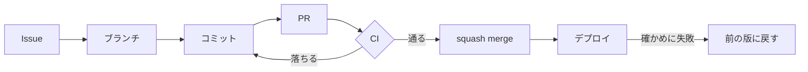

# 開発の流れ

変更は、Issue → ブランチ → コミット → PR → CI → マージ → デプロイ の順に進みます。main には PR を通してだけ入り、main に入ったものが自動でデプロイされます。



Claude Code で作業するときは、各段に [スキル](#claude-code-のスキル) があります。

## 1. Issue

Issue のテンプレートを選んで起票します（白紙の Issue は作れません）。

| テンプレート               | 使いどころ                                   | 付くラベル                                                            |
| -------------------------- | -------------------------------------------- | --------------------------------------------------------------------- |
| 不具合の報告               | 期待どおりに動かない                         | `bug`・`type:bug`・`status:triage`                                    |
| 機能の提案                 | あると旅の前の不安が減る機能                 | `type:feature`・`status:triage`                                       |
| 作業                       | 設定・整理・依存の更新など（開発する人向け） | `type:task`・`status:triage`                                          |
| 祭り情報の訂正             | 掲載している祭りの誤り                       | `data-correction`・`type:data`・`area:data`・`status:triage`          |
| 祭りの掲載・情報提供の依頼 | 祭りを運営する方からの掲載の依頼             | `listing-request`・`type:data`・`area:data`・`status:triage`          |
| 掲載停止の依頼             | 祭りを運営する方からの掲載停止の依頼         | `opt-out`・`type:data`・`area:data`・`priority:high`・`status:triage` |

### ラベル

ラベルは4つの系統に分けます。一覧は [`.github/labels.json`](../.github/labels.json) にあり、[`scripts/setup-github.sh`](../scripts/setup-github.sh) でリポジトリに入れます。

| 系統         | ラベル                                                                          | 付け方                                           |
| ------------ | ------------------------------------------------------------------------------- | ------------------------------------------------ |
| `type:*`     | `bug`・`feature`・`task`・`data`・`docs`                                        | 1つ。テンプレートが付ける                        |
| `area:*`     | `schema`・`server`・`agent-kit`・`web`・`3d`・`shiori`・`data`・`infra`・`docs` | 変える場所。複数可。コミットのスコープと同じ名前 |
| `priority:*` | `high`・`medium`・`low`                                                         | 見た人が付ける                                   |
| `status:*`   | `triage`（まだ見ていない）・`needs-info`・`ready`・`in-progress`・`blocked`     | 状態が変わったら付け替える                       |

`bug`・`data-correction`・`listing-request`・`opt-out` は、テンプレートが前から付けているラベルなので残しています。

GitHub の Issue Types は、組織のアカウントのリポジトリでしか使えません。このリポジトリは個人のアカウントのものなので、種類は `type:*` のラベルで分けます（`setup-github.sh check` の最後の行で、使えるかを確かめられます）。

## 2. ブランチ

`origin/main` から切ります。名前は中身を表す短い英語にします（例：`fix/day-trip-limit`、`feat/shiori-pdf`）。

## 3. コミット

[Conventional Commits](https://www.conventionalcommits.org/ja/v1.0.0/) で、1コミットに1つの目的を入れます。書き方は [CONTRIBUTING.md](../CONTRIBUTING.md#コミット) にあります。

- ファイルはパスを指定して足す（`git add -A`・`git add .` は使わない）
- 作者の設定は変えない。GitHub の noreply のアドレスを使う
- `--no-verify` は使わない。フックに止められたら書き方を直す

## 4. PR

[PR のテンプレート](../.github/pull_request_template.md) の見出し（変更の内容・関連する Issue・確かめたこと・チェック）を埋めます。マージは squash merge なので、PR のタイトルがそのまま main のコミットの要約になります。タイトルも Conventional Commits の形にします。

## 5. CI

[`ci.yml`](../.github/workflows/ci.yml) が、PR と main への push で次のジョブを並べて走らせます。同じ PR に新しい push があると、古い実行は止まります。pnpm のストア、Playwright のブラウザ、Docker のビルドの層はキャッシュします。

| ジョブ              | 中身                                                                                                                                                    |
| ------------------- | ------------------------------------------------------------------------------------------------------------------------------------------------------- |
| `lint`              | Biome（lint と format）                                                                                                                                 |
| `typecheck`         | すべてのパッケージの型                                                                                                                                  |
| `test`              | Vitest                                                                                                                                                  |
| `validate-data`     | 祭りのデータの検証（`pnpm validate:data`）                                                                                                              |
| `build`             | 画面と接客サーバーのビルド                                                                                                                              |
| `e2e`               | 接客サーバーをモック（`MATSURI_AGENT_MODE=mock`）で起動し、Playwright で画面の通しテスト。3つのジョブ（`e2e (1/3)` など）に分けて走らせ、結果をまとめる |
| `docker`            | デプロイと同じイメージを作り、モックで動かして、相談・しおりの PDF・3D のモデルが配られるかを確かめる                                                   |
| `secrets`           | gitleaks で、履歴全体に秘密情報が混ざっていないかを見る                                                                                                 |
| `actionlint`        | ワークフローの書き方（`run` の中のシェルも shellcheck で）                                                                                              |
| `dependency-review` | PR で足した依存に既知の脆弱性がないか（PR のときだけ）                                                                                                  |
| `検査とビルド`      | 上のすべての結果をまとめる                                                                                                                              |

main のルールセットは、上のすべてのジョブを必須の検査にします（`setup-github.sh` の `REQUIRED_CHECKS`）。ジョブの名前と `REQUIRED_CHECKS` が食い違うと、`scripts/github-config.test.ts` が落ちます。

ほかに [`codeql.yml`](../.github/workflows/codeql.yml) が、コード（TypeScript）とワークフローを CodeQL で解析し、結果を GitHub の Security の画面に出します（PR、main への push、毎週）。依存の更新は Dependabot が毎週 PR にします。

### 手元で CI と同じことをする

```bash
pnpm lint && pnpm typecheck && pnpm test && pnpm validate:data && pnpm build
```

e2e は、Playwright が接客サーバーをモックで起動し、画面の開発サーバーからつなぎます（`apps/web/playwright.config.ts`。ポートは 35179 と 38787）。CI では GPU のないランナーで 3D を描くので、1つのジョブのワーカーを1つにし、テストのファイルを3つのジョブに分けています（`--shard`）。

```bash
pnpm --filter @matsuri-ikoka/web test:e2e
```

### live で相談からしおりまで確かめる

CI はキーなしのモックで走るので、Claude を実際に呼ぶ確認は手元で行います。エージェントやプロンプト、ツールを変えたときは、`check:live -- --shiori` で、候補 → 祭りを選ぶ → 旅程 → 決定 → 確定前の再確認 → しおり（HTML と PDF）までを流し、段階ごとの OK / NG と、かかった時間・費用の合計を PR の「確かめたこと」に書きます。実在の祭りのデータで流す使い方（`--festivals` と `--say`）は [README の「Claude と話す（live）」](../README.md#claude-と話すlive) にあります。

```bash
MATSURI_AGENT_MODE=live MODEL_CONCIERGE=<モデル名> MODEL_STAFF=<モデル名> \
  pnpm --filter @matsuri-ikoka/server check:live -- --shiori
```

## 6. マージ

CI がすべて通ると、squash merge でマージできます。承認の数は求めていません。マージしたブランチは自動で消えます。

## 7. デプロイ

main に入ると [`deploy.yml`](../.github/workflows/deploy.yml) が Cloud Run に出します。手順、確かめること、前の版への戻し方は [運用と安全の仕様の「デプロイ」](spec/operations.md#デプロイ) にあります。

## Claude Code のスキル

開発用のスキル・エージェント・フックは、リポジトリの根の [`.claude/`](../.claude) にだけ置きます。

| スキル              | 使いどころ                                                                 |
| ------------------- | -------------------------------------------------------------------------- |
| `commit`            | 決まり（種類・スコープ・パスを指定した `git add`）に沿ってコミットする     |
| `create-issue`      | テンプレートとラベルを選んで Issue を起票する                              |
| `create-pr`         | PR のテンプレートに沿って PR を作る                                        |
| `review-pr`         | このリポジトリの決まり（`CLAUDE.md` の「守ること」）に照らして差分を見直す |
| `resolve-issue`     | Issue を1件選び、worktree で直して PR にし、CI が通ったらマージする        |
| `release-notes`     | main に入った変更から、使う人に向けた変更の一覧を作る                      |
| `setup-github-repo` | GitHub のリポジトリの設定（保護・必須の検査・ラベル）を入れる・確かめる    |
| `festival-research` | 公開の情報から祭りを調べ、出典と確度つきの祭りのデータにする               |

エージェント：`data-auditor`（祭りのデータを検品し、見つけたことを報告する。書き換えない）。

### マーケットプレイスのプラグイン

公式のマーケットプレイス（`claude-plugins-official`）のプラグインは、共有の設定（`.claude/settings.json`）では有効にしていません。

| プラグイン          | 扱い                                                                                                                                                |
| ------------------- | --------------------------------------------------------------------------------------------------------------------------------------------------- |
| `commit-commands`   | 使わない。変更をまとめて1つのコミットにし、スコープやパスを指定した `git add` の決まりを持たないため。代わりに `commit` スキルを使う                |
| `code-review`       | 入れない。Claude Code に組み込みの `/code-review` と `/security-review` で同じことができる。このリポジトリに固有の決まりは `review-pr` スキルで見る |
| `pr-review-toolkit` | 入れない。観点が `review-pr` スキルと組み込みの `/code-review` に重なる                                                                             |
| `typescript-lsp`    | 入れない。手元に言語サーバーを入れる必要があり、人によって環境が違う。使いたい人は手元の設定（`.claude/settings.local.json`）で有効にする           |

プラグインを足すときは、ここに名前と理由を書き、共有の設定に入れるかを PR で決めます。

## 開発用のものとアプリを分ける

開発用のスキル・エージェント・フック・`CLAUDE.md` は、アプリから読まれず、アプリと一緒に配られないようにします。

- 接客エージェントと再確認のエージェントは、ファイルの設定を読まない（`settingSources: []`、`strictMcpConfig: true`、`plugins: []`）。[接客エージェントの実行の仕様](spec/agent-runtime.md)
- コンテナには `.claude/`・`CLAUDE.md`・`.mcp.json` を入れない（[`.dockerignore`](../.dockerignore)）
- 祭りのデータの更新で Managed Agents に調査を頼むときは、渡すスキルを `festival-research` だけに明示する。`.claude/` を丸ごと渡さない
- [`scripts/dev-isolation.test.ts`](../scripts/dev-isolation.test.ts) が、これらが崩れていないかを確かめる（`apps/`・`packages/` などに開発用のファイルがないこと、アプリのソースが `.claude/` を参照しないこと、エージェントのオプションの `settingSources` がすべて空であること、`.dockerignore`）
