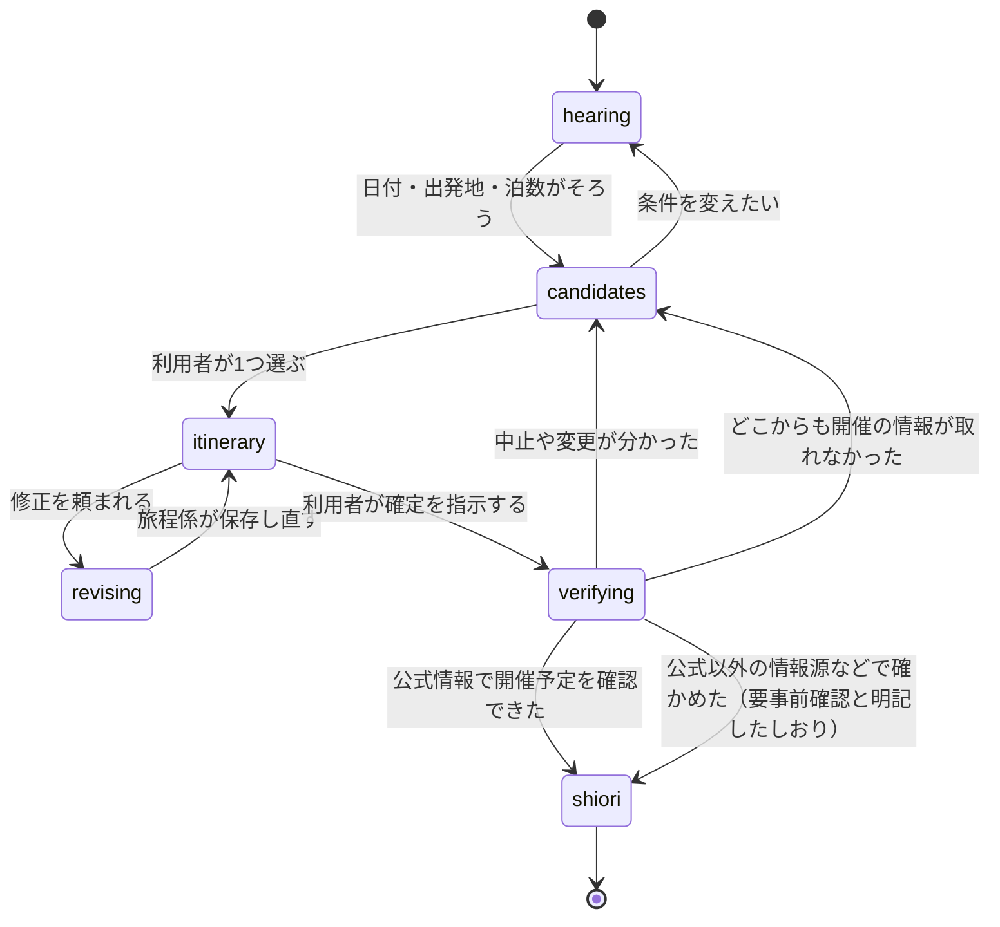

# 接客エージェントの仕様

## 役割

接客エージェントは4人です。利用者と話すのはコンシェルジュだけで、ほかの3人は裏で調べものをするスタッフとして、3D の店内のそれぞれの持ち場に立ちます。

| エージェント   | 店内の持ち場 | 責任                                                                               | 使えるツール                                                                                         |
| -------------- | ------------ | ---------------------------------------------------------------------------------- | ---------------------------------------------------------------------------------------------------- |
| コンシェルジュ | カウンター   | 条件とこだわりの聞き取り、スタッフへの依頼、結果をまとめた提案、利用者の確認を取る | サブエージェントの呼び出し、`note_conditions`、`update_itinerary`、`verify_festival`                 |
| 祭り調査係     | 資料棚の前   | 日程と出発地に合う祭りを探し、確度つきで返す                                       | `search_festivals`                                                                                   |
| 周辺係         | 地図の前     | 祭りの前後に入れる観光・食・休憩の場所を探す                                       | `search_nearby`                                                                                      |
| 旅程係         | 時刻表の前   | 移動時間と天気と宿の空きを確かめ、時刻つきの旅程を組む（何日かの旅は1日ずつ）      | `get_access`、`research_route`、`get_weather`、`search_nearby`、`search_lodging`、`update_itinerary` |

- モデルは役割ごとに環境変数で指定し、コードに書き込まない（下の「モデルの割り当て」）
- 利用者への質問は1回に2つまで。聞く項目と順番はコードで決める（下の「聞き取りの深さ」）
- スタッフは祭りのデータと決まった API しか使わない。Web の検索は、候補を出す前の開催の確かめ（`search_festivals` の中）と、確定前の再確認（`verify_festival`）だけに限る。どちらもツールの中の1回きりの `query()` で行い、スタッフには Web を渡さない
- サブエージェントは必要なときだけ呼ぶ。修正のときは旅程係だけを呼ぶ
- プロンプトは `apps/server/src/agent/prompts/` に Markdown で置き、Git で版を管理する。スタッフのプロンプトは短くし、担当のツールと返す形だけを書く

### モデルの割り当て

ふだんの仕事は Sonnet と Haiku で回し、いちばん大きいモデル（Opus）は、間違えたときの害が大きく、ほかでは補えない判断にだけ使います。

| 役割               | 環境変数                                        | 本番のモデル | 理由                                                                                                                                                                                                                             |
| ------------------ | ----------------------------------------------- | ------------ | -------------------------------------------------------------------------------------------------------------------------------------------------------------------------------------------------------------------------------- |
| コンシェルジュ     | `MODEL_CONCIERGE`                               | Sonnet       | 聞き取り、スタッフへの依頼、まとめ。計算と絞り込みはツールが済ませるので、会話と段取りの力があれば足りる                                                                                                                         |
| 祭り調査係・周辺係 | `MODEL_STAFF`（勧める値は `claude-sonnet-5-5`） | Sonnet       | ツールを呼んで結果を報告する。泊まりの旅では地域や日ごとの探し方を選ぶので、Haiku より Sonnet が安定する。候補を出す前の開催の確かめもこのモデルで行う                                                                           |
| 旅程係             | `MODEL_PLANNER`（省略時は `MODEL_STAFF`）       | Sonnet       | 祭りの時間・移動・営業時間・天気をまとめて時刻つきの旅程を組み、検証のエラーを読んで直す。守る条件が多い                                                                                                                         |
| 確定前の再確認     | `MODEL_VERIFIER`（省略時は `MODEL_STAFF`）      | Opus         | 形のそろっていない公式のページを読み、「予定どおり・要事前確認・変更・中止・確認できず」を決める。誤ると中止の祭りへ人を送ることになり、ページの中の指示に乗っ取られない強さも要る。確定のときにしか動かないので、費用は限られる |

## 会話の流れ

会話は6つの状態を進みます。状態はサーバーが持ち、画面は状態に合わせて切り替わります（`done` の `stage`）。

| 状態         | 次へ進む条件                                                                                  | 守ること                                                                                                              |
| ------------ | --------------------------------------------------------------------------------------------- | --------------------------------------------------------------------------------------------------------------------- |
| 聞き取り     | 日付、出発地、泊数（0〜6）がそろう。3泊からは旅のかたちも聞く（こだわりは初期値のままでよい） | 聞くのはコードが決めた項目だけで、1回に2つまで。言われたことは聞き直さない。近場のお出かけと分かれば0泊とする         |
| 祭りの候補   | 利用者が1つ選ぶ                                                                               | 候補は最大3つ。どこからも開催の情報が取れない祭りは出さない。公式以外の情報源などで確かめた祭りは「要事前確認」と出す |
| 旅程の案     | 利用者が確定を指示する                                                                        | 祭りの時間を先に固定して組む                                                                                          |
| 修正         | 旅程係が保存し直す                                                                            | 変更点を差分として返す                                                                                                |
| 確定前の確認 | 公式情報で開催予定を確認できた                                                                | 中止や変更が分かったら、候補に戻る                                                                                    |
| 旅のしおり   | 終わり                                                                                        | しおりは URL で共有でき、印刷できる                                                                                   |

### 聞き取る条件

条件は `TripConditionsSchema` です。祭りを探し始めるのに要るのは、日付・出発地・泊数の3つだけです。泊まりの旅では、ほかの項目も聞けます。どれも任意で、分からないときは推測で埋めず、「おまかせ」（`auto`）も選べます。

| 項目               | 意味                                                                                                                                                                                                                                                                                                                                                                 |
| ------------------ | -------------------------------------------------------------------------------------------------------------------------------------------------------------------------------------------------------------------------------------------------------------------------------------------------------------------------------------------------------------------- |
| `nights`           | 泊数。0 は日帰り・週末のお出かけ、1〜6 は泊まりの旅                                                                                                                                                                                                                                                                                                                  |
| `maxTravelMinutes` | 日帰りの片道の所要時間の上限（分。30〜600）。聞き取りの窓では1時間・2時間・3時間以内（`DAY_TRIP_TRAVEL_LIMITS`）を選べる。泊まりの旅では使わない                                                                                                                                                                                                                     |
| `party`            | 大人と子どもの人数（シニア・幼児の内訳は任意）                                                                                                                                                                                                                                                                                                                       |
| `budget`           | 旅全体の予算の上限（交通・宿・食事などを合わせた目安）。金額（`yen`）と数え方（`basis`：`perPerson` 1人あたり・`total` 全員の合計）を、言われた単位のまま持つ。1人あたりと合計の換算は `tripBudgetAmounts` で計算する（合計は幼児を除いた人数で割り、切り捨て）。店の記録には両方を書き、宿の空きの結果には、宿だけで1人あたりを超えるか（`overTripBudget`）を付ける |
| `lodgingBudget`    | 宿の予算の上限。1人あたりの円（`perPersonYen`）と、1泊あたりか泊まり全体か（`per`：`night`・`trip`）。幼児は人数に数えない                                                                                                                                                                                                                                           |
| `returnTo`         | 旅の終わりの場所（駅名まで）。出発地と違ってよい。ないときは出発地に戻る                                                                                                                                                                                                                                                                                             |
| `route`            | 旅のかたち（`stay` ずっと一か所・`loop` いくつかの地域を巡る・`via` 目的地への途中で祭りに寄る）と、回りたい地域（5つまで）                                                                                                                                                                                                                                          |
| `stayNear`         | 泊まる場所の希望（`festival` 祭りの近く・`town` 街）                                                                                                                                                                                                                                                                                                                 |
| `festivalDays`     | 祭りに行く日の数（`one` 1日だけ・`several` 何日か）                                                                                                                                                                                                                                                                                                                  |
| `pace`             | 旅のペース（`relaxed` ゆっくり・`normal` ふつう・`packed` たっぷり）                                                                                                                                                                                                                                                                                                 |
| `interests`        | 祭りのほかに楽しみたいこと（温泉・食・自然・街歩き・歴史・買い物）。空の並びは「特にない」                                                                                                                                                                                                                                                                           |
| `foodWishes`       | 食べたいもの（海鮮・肉料理・野菜中心・麺類・郷土料理・ご当地とB級グルメ・和食・甘味とカフェ・屋台・地酒と地ビール）。空の並びは「こだわらない」。屋台のほかのものがあれば、`search_nearby` は「屋台で十分」でも店を残す                                                                                                                                              |
| `dietary`          | 食事で気をつけたいこと（ベジタリアン・ヴィーガン・ハラール・食物アレルギー・生ものが苦手）。店の対応はデータにないので、対応しているとは書かず、店に確かめるよう伝える。アレルギーの中身は持たない                                                                                                                                                                   |
| `transport`        | 想定している交通手段（車・新幹線・在来線・バス・船・飛行機・レンタカー・徒歩。いくつでも、`TRANSPORT_MODES`）。空の並びは「おまかせ」。`get_access` は、選んだ手段で道のりを組む決まりを `rules` に入れる。車かレンタカーなら駐車場と交通規制を先に確かめ、バス・船・飛行機の便と時刻はデータにないので書かない                                                      |
| `leaveToStaff`     | 「あとはおまかせ」。`true` のとき、まだ聞いていない項目は聞かずに組む                                                                                                                                                                                                                                                                                                |

### 聞き取りの深さ

聞く項目は泊数で変わります。決めるのは `apps/server/src/domain/hearing.ts` の `planHearing` で、コンシェルジュは `note_conditions` の結果（店の記録の「次に聞くこと」）にある項目だけを、1回に2つまで聞きます。言われた項目は聞き直さず、自由な言葉から読み取れるものは読み取って書き留めます。「おまかせ」（`auto`）や「あとはおまかせ」のあとは聞きません。

| 泊数                  | 探し始める前に聞くこと                         | 旅程を組む前に聞くこと                                                           |
| --------------------- | ---------------------------------------------- | -------------------------------------------------------------------------------- |
| 0（日帰り・お出かけ） | 日付・出発地・泊数だけ                         | なし                                                                             |
| 1〜2泊                | 日付・出発地・泊数だけ                         | 祭りを選んだら泊まる場所の希望。旅の間に何日も開かれる祭りなら、祭りに行く日の数 |
| 3〜6泊                | 旅のかたち（巡る・途中で寄るなら回る地域まで） | 終わりの場所・ペース・楽しみ（何日も開かれる祭りなら、祭りに行く日の数も）       |

長い旅では、祭りは旅の中に1つあれば十分です。旅程係は旅のかたちに沿って組みます（ずっと一か所は拠点から出かける、巡るは泊まる地域を移す、途中で寄るは道の途中で祭りに寄って引き返さない）。

## ツール

カスタムツールは8つです。計算や絞り込みはツールの中のコード（`apps/server/src/domain/`）で済ませ、Claude には結果だけを返します。入出力は Zod で定義します。

| ツール             | 入力                                                                                                          | 出力                                                                                                                                                                     | コードで守るルール                                                                                                                                                                                                                                                                                                                                                                                                                                                                                                                                |
| ------------------ | ------------------------------------------------------------------------------------------------------------- | ------------------------------------------------------------------------------------------------------------------------------------------------------------------------ | ------------------------------------------------------------------------------------------------------------------------------------------------------------------------------------------------------------------------------------------------------------------------------------------------------------------------------------------------------------------------------------------------------------------------------------------------------------------------------------------------------------------------------------------------- |
| `note_conditions`  | 発言から読み取れた旅の条件（言われた項目だけ）                                                                | 書き留めた条件、まだ分からない項目、次に聞くこと、探してよいか、組んでよいか                                                                                             | 聞く項目と順番は `planHearing` で決める。画面にはイベントを出さない                                                                                                                                                                                                                                                                                                                                                                                                                                                                               |
| `search_festivals` | 希望日（または期間）、今日の日付、出発地、泊数（`nights`。0 は日帰り・お出かけ）、こだわり                    | 祭りの候補（最大3件）、希望日からのずれ、確度、出典、候補ごとの開催の確かめの結果（`factCheck`）                                                                         | [日程のルール](itinerary.md#日程のルール)。日帰り（0泊）は移動時間の上限（`maxTravelMinutes`。言われていなければ150分）を超える祭りを除く。出発の駅からの所要時間がデータにない祭りは、駅の位置から見積もり（`travelBasis: "estimate"`）、下限でも上限を超えるものを除き、境目のもの（`travelFit: "uncertain"`）は残して知らせる。上限を言われたら、必ず守る条件として、希望日より先に、収まる祭りを並べる。掲載停止の祭りは出さない。候補を返す前に、開催を公式の情報で確かめる（[候補を出す前の確かめ](agent-runtime.md#候補を出す前の確かめ)） |
| `search_nearby`    | 祭りの ID、または地域の名前と日付。使える時間帯、こだわり（だれと・どんな場所・ごはん）                       | 観光・食・休憩の場所（種類、移動の時間、営業時間、定休日、出典）。地域で探したときは、場所の持ち主の祭りと、その日にその地域で開かれる祭り                               | 当日が休業日の場所は除く。営業時間の外に入る予定は作らない。地域で探しても、祭りのデータにある場所だけを返す                                                                                                                                                                                                                                                                                                                                                                                                                                      |
| `get_access`       | 出発地、目的地（祭りの ID または場所）                                                                        | 最寄り駅、徒歩の時間、主要駅からの所要時間、出発の駅からの所要時間の目安（データか駅の位置からの見積もり）、駐車場の有無、交通規制                                       | 保存してある公式のアクセス案内だけを使い、必ず「目安」と付ける。旅程は出発の駅から始めるよう `notes` で伝える                                                                                                                                                                                                                                                                                                                                                                                                                                     |
| `research_route`   | 祭りの ID、出発の駅（省略すると相談の出発地）、行く日、着きたい時刻                                           | 出発の駅・最寄り駅、駅の位置からの見積もり、調べた行き方（所要時間の幅・路線と乗り換えの要約・出典）、旅程の始め方の決まり                                               | Web の検索と取得だけを使う1回きりの `query()`（[行き方の調べ](agent-runtime.md#行き方の調べresearch_route)）。調べた所要時間は見積もりと照らし、食い違えば使わない。画面にはイベントを出さない                                                                                                                                                                                                                                                                                                                                                    |
| `get_weather`      | 場所、日付                                                                                                    | 天気、降水確率、最高・最低気温、出典                                                                                                                                     | 予報の範囲外の日は「予報前」と返す                                                                                                                                                                                                                                                                                                                                                                                                                                                                                                                |
| `search_lodging`   | 祭りの ID（会場の近く）、チェックインの日、泊数、半径（3km まで）、人数と宿の予算（省略すると聞き取った条件） | 宿の候補（名前・1泊の料金（全員分）・予約のページ・会場からの直線の距離・予算の計算）、調べた時刻、注意の一文、出典のクレジット。調べられないときは `unavailable` と理由 | 宿泊予約の API の結果だけを返す（[宿の空き](#宿の空き)）。予算の合計と上限を超えるかはコードで計算する。結果は相談に残し、旅程の保存のとき、チェックインの日の泊まりに付ける（2泊以上でも、続く夜には付けない）。画面にはイベントを出さない                                                                                                                                                                                                                                                                                                       |
| `update_itinerary` | 日ごとの旅程（1〜7日）の全体、または1日（`addDay`。足す・置き換える）                                         | 保存の結果、前の版からの差分、検証のエラー                                                                                                                               | スキーマで検証し、日ごとに、祭りの時間と重なる予定や営業時間の外の予定は受け付けない。出発の駅から始まらない旅程と、日帰りで行きの移動が片道の上限を明らかに超える旅程は保存しない（[行き方の調べ](agent-runtime.md#行き方の調べresearch_route)）。天気は日ごとに付ける                                                                                                                                                                                                                                                                           |
| `verify_festival`  | 祭りの ID、日付（省略すると旅程の日）                                                                         | 結果（予定どおり・要事前確認・変更・中止・確認できず）、確認した出典、確認した時刻、旅程に反映したか、開催日までの日数                                                   | Web の検索と取得だけを使う1回きりの `query()` で、公式サイトを優先する。Web で確かめられなくても、データの公式の出典で当年の開催を確かめてあれば予定どおりにする。公式以外の情報源などで確かめたときは、要事前確認と明記したしおりにする。どこからも情報が取れないときは、ほかの候補に戻る。1回の発言に1回まで                                                                                                                                                                                                                                    |

### 宿の空き

`search_lodging` は、泊まりの旅の計画の壁（泊まれる宿があるか、予算に収まるか）を、手配の手前で取り除くための道具です。設計の判断は [ADR 0006](../adr/0006-lodging-search.md) にあります。

- **調べ方**：キー（`RAKUTEN_APPLICATION_ID`・`RAKUTEN_ACCESS_KEY`）があれば楽天トラベルの空室検索 API で、祭りの会場を中心に半径 3km までを、安い順に調べる。キーがないときは、開発では架空の宿（名前に「（架空）」、URL は `example.com`）、本番では「調べられない」と返す。モックモードは記録した相談を再生するので、API を呼ばない
- **人数**：大人（シニアを含む）・小学生・幼児に分けて渡し、1部屋で調べる。小学生は高学年の料金として、幼児は食事と布団なしとして数える（料金を低く見積もらないため）。どれかが10人を超えたら調べない
- **料金**：宿ごとに、いちばん安いプランの1泊目の合計を「1泊の料金（全員分）」とする。プランの料金がないときは、宿の最安値の目安（1部屋1泊）を使う。泊まり全体の合計・1人あたり・予算を超えるかは `apps/server/src/domain/lodging.ts` で計算する。幼児は1人あたりの人数に数えない
- **信用しない入力として扱う**：返答は使う項目だけを検証して取り出す。名前の制御文字を除き、予約のページは楽天のドメインの https の URL だけを受け付ける。緯度・経度は日本の範囲のものだけを使う
- **伝え方**：名前と料金は結果にあるものだけを使い、調べた時刻と「料金と空きは、予約の時点で変わることがあります」を必ず添える。楽天の結果には、クレジット「Supported by Rakuten Developers」を出典の `title` に入れる
- **呼び出しの上限**：1本ずつ、1.5秒以上の間隔を空けて呼び、同じ条件の結果は5分だけ使い回す。429 は「混み合っている」、404 は「空きなし」として扱う

## フックと画面の動き

ツールの前後でフックがイベントを出し、SSE で画面に送ります。画面はイベントを受けてストアを更新し、スタッフの動き・吹き出し・会話欄の作業の記録・相談の進み具合を切り替えます。

| 契機                               | イベント                                    | スタッフの動き                   |
| ---------------------------------- | ------------------------------------------- | -------------------------------- |
| サブエージェントの開始             | `staff.start`                               | 持ち場へ歩く                     |
| `search_festivals` の前            | `tool.start`                                | 調査係が資料棚をめくる           |
| 候補の開催を確かめた（ツールの中） | `festival.verified`（`scope: "candidate"`） | 候補カードに確かめた結果を付ける |
| `search_nearby` の前               | `tool.start`                                | 周辺係が地図を指さす             |
| `get_access`・`get_weather` の前   | `tool.start`                                | 旅程係が時刻表を見上げる         |
| ツールの後                         | `tool.end`                                  | 小さくうなずく                   |
| `update_itinerary` の後            | `itinerary.updated`                         | 旅程係がカウンターへ書類を運ぶ   |
| `verify_festival` の後             | `festival.verified`（`scope: "itinerary"`） | コンシェルジュがはんこを押す     |
| 返答の文章                         | `message.delta`                             | コンシェルジュが話す             |

画面は、このイベントの並びから、コンシェルジュの頼みとスタッフどうしの受け渡し（祭り調査係・周辺係 → 旅程係、各スタッフ → コンシェルジュ）を組み立てて見せます。頼みと受け渡しのための別のイベントは送りません（[画面の仕様](screens.md#スタッフどうしの頼みと受け渡し)）。

`PreToolUse` のフックは、イベントを出すほかに、次を守ります（`apps/server/src/agent/hooks.ts`）。

- スタッフと使えるツールの組み合わせ（[API の仕様](api.md#スタッフと作業)の表）。ほかのツールは断る
- スタッフを呼べるのはコンシェルジュだけで、同じスタッフは1回の発言に1回まで
- `verify_festival` は1回の発言に1回まで

## コンシェルジュが守るルール

コンシェルジュの指示には、次のルールを入れます。どれも誤った案内をしないためのものです。

**情報の扱い**

1. 祭りの日時・場所・料金は、ツールの結果にあるものだけを使う。自分の知識で補わない
2. 確度が「推定」「1つの情報源だけ」の情報は、そう明記する
3. 開催が確認できていない祭りを、確定した旅程に入れない
4. 移動時間はツールの「目安」をそのまま使い、自分で計算しない
5. 出典を必ず添える

**会話**

6. 質問は1回に2つまで（聞く項目はコードが決める）。探してよくなったら、すぐ調べ始める
7. 候補は最大3つ。祭りごとに「なぜあなたに合うか」を1文で言う
8. 祭りの大小を問わず、その祭りならではの見どころと、その土地の味を必ず紹介する
9. 利用者が「決定」と言うまで、旅程を確定扱いにしない

**子連れと安全**

10. 子連れのときは、休憩、トイレ、帰りの混雑、夜の冷え込みに触れる
11. 荒天で中止になりうる祭りには、雨の日の代わりの過ごし方を1つ添える

**口調**

12. 小さな町の旅行代理店の店員として、親しみやすく、短く話す。吹き出しに収まる長さを意識する

## 開発環境からの切り離し

接客エージェントは、開発用の設定・`CLAUDE.md`・スキルを読み込まないように動かします。組み込みのファイル操作とシェルは許可せず、渡した MCP サーバーのツールだけを使わせます。詳しくは [アーキテクチャ](../architecture.md#接客エージェントを開発環境から切り離す) にあります。
