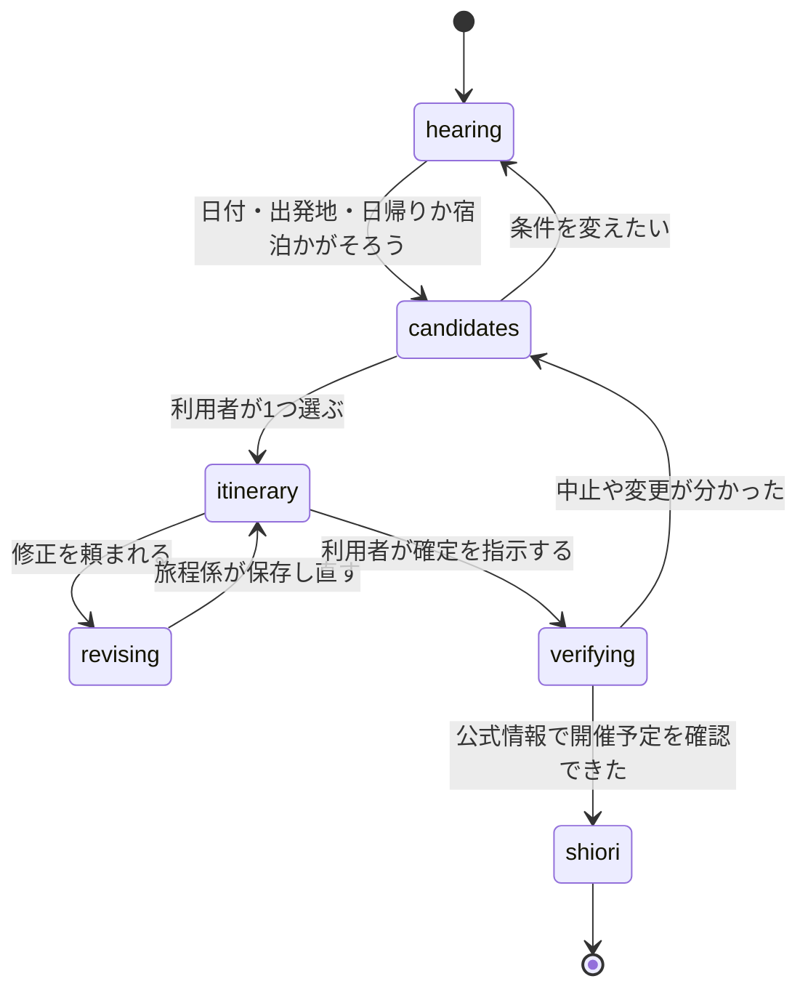

# 接客エージェントの仕様

## 役割

接客エージェントは4人です。利用者と話すのはコンシェルジュだけで、ほかの3人は裏で調べものをするスタッフとして、3D の店内のそれぞれの持ち場に立ちます。

| エージェント   | 店内の持ち場 | 責任                                                                               | 使えるツール                                                      |
| -------------- | ------------ | ---------------------------------------------------------------------------------- | ----------------------------------------------------------------- |
| コンシェルジュ | カウンター   | 条件とこだわりの聞き取り、スタッフへの依頼、結果をまとめた提案、利用者の確認を取る | サブエージェントの呼び出し、`update_itinerary`、`verify_festival` |
| 祭り調査係     | 資料棚の前   | 日程と出発地に合う祭りを探し、確度つきで返す                                       | `search_festivals`                                                |
| 周辺係         | 地図の前     | 祭りの前後に入れる観光・食・休憩の場所を探す                                       | `search_nearby`                                                   |
| 旅程係         | 時刻表の前   | 移動時間と天気を確かめ、時刻つきの旅程を組む                                       | `get_access`、`get_weather`、`update_itinerary`                   |

- モデルは役割ごとに環境変数で指定し、コードに書き込まない（下の「モデルの割り当て」）
- 利用者への質問は1回に1つまで
- スタッフは祭りのデータと決まった API しか使わない。Web 検索は `verify_festival` の再確認だけに限る
- サブエージェントは必要なときだけ呼ぶ。修正のときは旅程係だけを呼ぶ
- プロンプトは `apps/server/src/agent/prompts/` に Markdown で置き、Git で版を管理する。スタッフのプロンプトは短くし、担当のツールと返す形だけを書く

### モデルの割り当て

ふだんの仕事は Sonnet と Haiku で回し、いちばん大きいモデル（Opus）は、間違えたときの害が大きく、ほかでは補えない判断にだけ使います。

| 役割               | 環境変数                                   | 本番のモデル | 理由                                                                                                                                                                                                                 |
| ------------------ | ------------------------------------------ | ------------ | -------------------------------------------------------------------------------------------------------------------------------------------------------------------------------------------------------------------- |
| コンシェルジュ     | `MODEL_CONCIERGE`                          | Sonnet       | 聞き取り、スタッフへの依頼、まとめ。計算と絞り込みはツールが済ませるので、会話と段取りの力があれば足りる                                                                                                             |
| 祭り調査係・周辺係 | `MODEL_STAFF`                              | Haiku        | ツールを1回呼んで結果を報告するだけ                                                                                                                                                                                  |
| 旅程係             | `MODEL_PLANNER`（省略時は `MODEL_STAFF`）  | Sonnet       | 祭りの時間・移動・営業時間・天気をまとめて時刻つきの旅程を組み、検証のエラーを読んで直す。守る条件が多い                                                                                                             |
| 確定前の再確認     | `MODEL_VERIFIER`（省略時は `MODEL_STAFF`） | Opus         | 形のそろっていない公式のページを読み、「予定どおり・変更・中止・確認できず」を決める。誤ると中止の祭りへ人を送ることになり、ページの中の指示に乗っ取られない強さも要る。確定のときにしか動かないので、費用は限られる |

## 会話の流れ

会話は6つの状態を進みます。状態はサーバーが持ち、画面は状態に合わせて切り替わります（`done` の `stage`）。

| 状態         | 次へ進む条件                                                         | 守ること                                                    |
| ------------ | -------------------------------------------------------------------- | ----------------------------------------------------------- |
| 聞き取り     | 日付、出発地、日帰りか宿泊かがそろう（こだわりは初期値のままでよい） | 同行者と好みは任意。足りないものは1つずつ聞く               |
| 祭りの候補   | 利用者が1つ選ぶ                                                      | 候補は最大3つ。開催が確認できていない祭りは「未確認」と出す |
| 旅程の案     | 利用者が確定を指示する                                               | 祭りの時間を先に固定して組む                                |
| 修正         | 旅程係が保存し直す                                                   | 変更点を差分として返す                                      |
| 確定前の確認 | 公式情報で開催予定を確認できた                                       | 中止や変更が分かったら、候補に戻る                          |
| 旅のしおり   | 終わり                                                               | しおりは URL で共有でき、印刷できる                         |

## ツール

カスタムツールは6つです。計算や絞り込みはツールの中のコード（`apps/server/src/domain/`）で済ませ、Claude には結果だけを返します。入出力は Zod で定義します。

| ツール             | 入力                                                               | 出力                                                                   | コードで守るルール                                                                                            |
| ------------------ | ------------------------------------------------------------------ | ---------------------------------------------------------------------- | ------------------------------------------------------------------------------------------------------------- |
| `search_festivals` | 希望日（または期間）、今日の日付、出発地、日帰りか宿泊か、こだわり | 祭りの候補（最大3件）、希望日からのずれ、確度、出典                    | [日程のルール](itinerary.md#日程のルール)。日帰りは移動時間の上限を超える祭りを除く。掲載停止の祭りは出さない |
| `search_nearby`    | 祭りの ID、使える時間帯、こだわり（だれと・どんな場所・ごはん）    | 観光・食・休憩の場所（種類、移動の時間、営業時間、定休日、出典）       | 当日が休業日の場所は除く。営業時間の外に入る予定は作らない                                                    |
| `get_access`       | 出発地、目的地（祭りの ID または場所）                             | 最寄り駅、徒歩の時間、主要駅からの所要時間、駐車場の有無、交通規制     | 保存してある公式のアクセス案内だけを使い、必ず「目安」と付ける                                                |
| `get_weather`      | 場所、日付                                                         | 天気、降水確率、最高・最低気温、出典                                   | 予報の範囲外の日は「予報前」と返す                                                                            |
| `update_itinerary` | 旅程の全体、または変える部分                                       | 保存の結果、前の版からの差分、検証のエラー                             | スキーマで検証し、祭りの時間と重なる予定や営業時間の外の予定は受け付けない                                    |
| `verify_festival`  | 祭りの ID                                                          | 結果（予定どおり・変更・中止・確認できず）、確認した出典、確認した時刻 | 組み込みの Web 検索を使い、公式サイトを優先する。確認できないときは確定させない                               |

## フックと画面の動き

ツールの前後でフックがイベントを出し、SSE で画面に送ります。画面はイベントを受けてストアを更新し、スタッフの動き・吹き出し・会話欄の作業の記録・相談の進み具合を切り替えます。

| 契機                             | イベント            | スタッフの動き                 |
| -------------------------------- | ------------------- | ------------------------------ |
| サブエージェントの開始           | `staff.start`       | 持ち場へ歩く                   |
| `search_festivals` の前          | `tool.start`        | 調査係が資料棚をめくる         |
| `search_nearby` の前             | `tool.start`        | 周辺係が地図を指さす           |
| `get_access`・`get_weather` の前 | `tool.start`        | 旅程係が時刻表を見上げる       |
| ツールの後                       | `tool.end`          | 小さくうなずく                 |
| `update_itinerary` の後          | `itinerary.updated` | 旅程係がカウンターへ書類を運ぶ |
| `verify_festival` の後           | `festival.verified` | コンシェルジュがはんこを押す   |
| 返答の文章                       | `message.delta`     | コンシェルジュが話す           |

## コンシェルジュが守るルール

コンシェルジュの指示には、次のルールを入れます。どれも誤った案内をしないためのものです。

**情報の扱い**

1. 祭りの日時・場所・料金は、ツールの結果にあるものだけを使う。自分の知識で補わない
2. 確度が「推定」「1つの情報源だけ」の情報は、そう明記する
3. 開催が確認できていない祭りを、確定した旅程に入れない
4. 移動時間はツールの「目安」をそのまま使い、自分で計算しない
5. 出典を必ず添える

**会話**

6. 質問は1回に1つまで。条件がそろったら、すぐ調べ始める
7. 候補は最大3つ。祭りごとに「なぜあなたに合うか」を1文で言う
8. 祭りの大小を問わず、その祭りならではの見どころと、その土地の味を必ず紹介する
9. 利用者が「決定」と言うまで、旅程を確定扱いにしない

**子連れと安全**

10. 子連れのときは、休憩、トイレ、帰りの混雑、夜の冷え込みに触れる
11. 荒天で中止になりうる祭りには、雨の日の代わりの過ごし方を1つ添える

**口調**

12. 小さな町の旅行代理店の店員として、親しみやすく、短く話す。吹き出しに収まる長さを意識する

## 開発環境からの切り離し

接客エージェントは、開発用の設定・`CLAUDE.md`・スキルを読み込まないように動かします。組み込みのファイル操作とシェルは許可せず、渡した MCP サーバーのツールだけを使わせます。詳しくは [アーキテクチャ](../architecture.md#接客エージェントを開発環境から切り離す) にあります。
