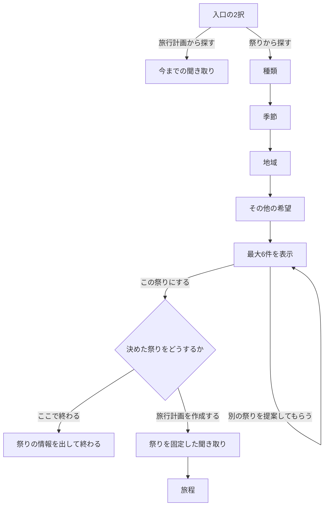

# 祭りから探す

相談の入口を2つにする。行きたい祭りがまだ分からない人は「祭りから探す」、日程や出発地が先に決まっている人は「旅行計画から探す」を選ぶ。情報の壁（どんな祭りがあるか分からない）を、日程を決める前に取り除くためのもの。

型は [`packages/schema/src/festivalSearch.ts`](../../packages/schema/src/festivalSearch.ts) が正。

## 流れ

入口を選ばずに文字で話しかけたときは、今までの相談として受ける。

## 聞くこと

| 項目         | 選択肢                                                                                     | 選び方           |
| ------------ | ------------------------------------------------------------------------------------------ | ---------------- |
| 種類         | 花火・地域の祭り・伝統的な祭り・参加型の祭り・マイナーなお祭り・メジャーなお祭り・おまかせ | いくつでも       |
| 季節         | 春・夏・秋・冬・おまかせ（季節で絞らない）                                                 | 1つ              |
| 地域         | 地方を選び、その中の都道府県（47都道府県）。おまかせは全国                                 | いくつでも       |
| その他の希望 | 自由記述（200字まで）                                                                      | 書かなくてもよい |

## 探し方

検索は3段に分ける。上の段の判断を、下の段が変えることはない。

1. **必ず守る条件（コード）**：種類・季節・地域・掲載停止・中止と延期・過ぎた日。合わない祭りは候補に出さない
2. **自由記述の読み取り**：自由記述を、並び順に効かせる形（`FestivalWishIntent`）に読む。モデルが使えるときはモデルで読み、使えないとき（モックと CI、失敗や時間切れ）は言葉の辞書で読む。読み方は結果の `reading` で画面に出す
3. **並べる（コード）**：点を付けて並べ、同じ県・同じ種類に偏らないように6件を選ぶ

自由記述で祭りを増やしたり、条件に合わない祭りを出したりしない。自由記述に合わない祭りは下に並べ、`wishFit` を `none` にして、合うと言えないことを画面に出す。

### 種類の判定

種類は3つの軸に分ける。**軸の中はどれかに合えばよく、軸どうしはすべて合う祭りを出す**（例：伝統的＋マイナー は、伝統的で、かつマイナー）。

| 軸       | 種類         | 強く合う                                                          | 弱く合う（強く合う祭りのあとに並べる）                                                           |
| -------- | ------------ | ----------------------------------------------------------------- | ------------------------------------------------------------------------------------------------ |
| ジャンル | 花火         | `category` が `fireworks`                                         | 見どころに花火がある                                                                             |
| ジャンル | 地域の祭り   | `styles` に `community`                                           | `styles` が空で、規模が XS〜M、知名度が major でなく、種類が fireworks でない                    |
| ジャンル | 伝統的な祭り | `styles` に `traditional`                                         | `styles` が空で、見どころか小話に文化財・由来の年代の言葉があり、種類が fireworks・market でない |
| 参加     | 参加型の祭り | `etiquette.participation` が `join_open` か `join_by_application` | なし（`unknown` は合わないとする）                                                               |
| 知名度   | マイナー     | `popularity` が `local`                                           | なし                                                                                             |
| 知名度   | メジャー     | `popularity` が `major`                                           | `popularity` が `regional` で、規模が L                                                          |

申し込みの要る参加型は、理由に「申し込みが必要」と添える。

### 季節と行く日

季節は開催の日の月で決める（春3〜5月・夏6〜8月・秋9〜11月・冬12〜2月）。何日かにまたがる開催は、どれかの日が季節に入れば合うとする。

候補の日は、今日以降で季節に入る、いちばん早い開催回。季節がおまかせなら、今日以降でいちばん早い開催回。今日以降の開催回がデータにない祭りは出さない（日付を推測しない）。

候補の `daysFromWish` は 0。開催回が例年の見込み（`expected`）なら `confirmed` は false で、画面に「要事前確認」と出す。

### 点の付け方

点の高い順に並べ、次の順で比べる。

1. 自由記述に合う度合い（名前の完全な一致、見どころ・小話・作法・地元の味の言葉の一致、種類の一致、希望の月、希望の県、加わりたいとの一致。避けたい言葉は減点）
2. 種類の強い一致が弱い一致より先
3. 開催が確かめられている祭りが先
4. 相談ごとに決まる乱数（同じ相談では同じ順になり、「別の祭りを提案してもらう」で順がずれない）

選ぶときは、1回の6件に同じ `category` は3件まで、地域が全国か複数の県のときは同じ県は2件までにする。足りなければこの制限を1つずつ緩めて埋める。ただし、自由記述に合う度合いが上の祭りが残っているのに、下の祭りを偏りを抑えるために出すことはしない（「花火が見たい」で、合う花火が残っているのに合わない祭りを混ぜない）。種類に強く合う祭りが残っているのに、弱く合う祭りを出すこともしない（花火大会が残っているのに、見どころに花火があるだけの祭りを混ぜない）。

`wishFit` は、読み取った希望がすべて合えば `matched`、一部なら `partial`、1つも合わなければ `none`。祭りのデータの値で合わないと分かるとき（写真の禁止、荒い祭りと子連れなど）と、避けたいことに当たるときは `matched` にしない。自由記述があっても希望を1つも読み取れなければ `null` にする（どの祭りにも「合うと言えない」と出さない）。同じ意味の言葉は1つの希望として数え、「屋台はありません」のように否定している文は一致にしない。

文字の形だけで合うとしない。祭りの文に当てる言葉は、その希望に向くことを表す言い方に絞り、自由記述の読み取りにだけ使う言葉と分ける（子連れは親子・ベビーカー・子ども向けなどを文に当て、「子ども」「家族」の文字だけでは合うとしない。屋台は山車を指す土地もあるので「屋台が並ぶ」などに絞る。「夜」「雪」「桜」の1字は文に当てない）。祭りのデータの値を文の一致より先に見る。子連れは、危険の度合いが high、終わりが21時以降か日をまたぐ、未明に始まる、名前か見どころに裸・奪い合い・喧嘩・火の粉・深夜などがあれば合わないとする（`kid_friendly` の場所か、危険の度合いが low なら合うとする）。静かは、混む祭りと、名前か見どころに荒い言葉や勇壮・熱気などがあれば合わないとする。

種類の一致は、文の一致（名前に言葉があるときを含む）より高い点にする。灯りは種類の `lantern` として読む（灯籠・提灯・行灯・万灯・キャンドル・ライトアップ・幻想的など）。

読み取りの言葉（`terms`・`avoidTerms`）は、次のように照らし合わせる。辞書の言葉を含む言い方（子ども向け）は辞書の呼び方に当てる。辞書にない言葉は祭りの文に当てる。自由記述に書かれていない言葉はモデルの足した言い換えとして、まとめて1回だけ点を足す（言い換えの多い希望だけが強くならないように）。言い換えはほかに希望があれば希望の数に入れず、自由記述に書かれた言葉に当たらなかったときはその言葉の代わりとして数える。ほかの言葉を含むだけの長い言い方（鬼が出てくる・鬼）は別の希望にしない。1字の言葉は漢字だけを、会場と市町村の名前を除いて当てる。名前の完全な一致の点は、自由記述に名前が書かれているときだけ付ける。

### 別の祭りを提案してもらう

見せた祭りの ID を `excludeIds` に入れて探し直す。条件にすべて合う祭りを見終えるまで、同じ祭りは出ない。`remaining` が 0 になったらボタンを閉じ、「これで全部です」と出して次の手を並べる。

### 見つからないとき

条件を黙って緩めない。0件なら「条件に合う祭りは見つかりませんでした」と出し、次を返す。

- `nearMatches`：条件を1つだけ外せば出る祭り（外れている点を添える）。候補とは分けて出す
- `next`：次の手。季節を問わない・種類を問わない・隣の県まで・全国。変えた条件で数え、祭りのあるものだけを出す。最後に「条件を選び直す」

### 開催の確かめ

探す段階では Web で確かめない（6件を待たせずに出すため）。出典と確度はカードに出す。旅行計画を作成するときに、選んだ祭りの開催を今までの手順で確かめ、中止と分かったら旅程を組まずに結果へ戻す。

## 決めた祭りをどうするか

祭りを選ぶと「旅行計画を作成する」「ここで終わる」「ほかの祭りを見る」を出す。

「ここで終わる」は、祭りの日時・場所・作法の要点・出典を出して、モデルを呼ばずに終える。行く前に主催者の案内で確かめるよう添え、「はじめに戻る」で入口へ戻れる。

## 祭りを固定した旅程

「旅行計画を作成する」を選ぶと、「旅行計画から探す」と同じ聞き取りに進む。違うのは次の点。

| 段階   | 違い                                                                                                              |
| ------ | ----------------------------------------------------------------------------------------------------------------- |
| 日程   | 開催回から行く日を選び（1回だけなら確認のみ）、日帰りか泊数を選ぶ。カレンダーでは、行く日を含まない期間を選べない |
| 行き先 | 祭りの開催地を「必ず行く」として外せない形で出し、それに加えて寄りたい場所を選ぶ。日帰りでは聞かない              |
| 確認   | 組み立ての結果（`AnchorPlan`）を出し、入れる場所・余裕があれば入れる場所・今回は外す場所と理由が分かるようにする  |

旅程の組み立てでは祭りの検索をしない。送るときに `ChatRequest.anchor` を添える。

### 必ず行く場所と、寄りたい場所

**選んだ祭りは必ず旅程に入れる。寄りたい場所は希望で、入らないときは外す。** 例えば、A県の祭りを選んだ人が「B県とC県にも行きたい」と言ったら、A県は必ず入れ、B県とC県は時間と距離で判断する。

判断はコード（`POST /api/festival-trips/preview`）で行い、モデルに決めさせない。

1. 寄りたい場所を都道府県に直す。地方の名前は、その中で祭りの開催地にいちばん近い県に当てる。都道府県に当たらない地名は `maybe` にして旅程係に判断を渡す
2. 祭りの開催地と同じ県は `included`
3. 旅の使える時間を出す。1日に動ける時間はペースで決める（ゆっくり8時間・ふつう10時間・たっぷり12時間）。祭りに `start`・`end` があればその長さ、なければ3時間を祭りの滞在に取る
4. 出発地 → 寄る場所 → 祭り → 寄る場所 → 帰り の順を、移動の見積もり（`travelEstimate`）が短くなるように決める。1か所につき滞在を3時間（ゆっくりは4時間）取る
5. 寄り道の増える時間が少ない場所から順に足していき、使える時間に収まるものは `included`、次の1か所で超えるものは `maybe`、それ以外は `dropped` にして理由を型で作る
6. 泊数と順から `startDate`・`endDate` を決める。祭りの日は必ず入れる。祭りの日より前に寄る場所があれば、初日を前にずらす
7. 祭りに間に合わない泊数（日帰りで片道が長すぎるなど）なら `warnings` に書き、`minNights` を返す。旅程は作れるが、画面で泊数の見直しを勧める。その日のうちに帰るのは23時までに帰り着けるときだけとする（地方は終電が早く、夜に終わる祭りのあとに帰れないことが多いため）

### 旅程係への渡し方

`AnchorPlan` を店の記録に入れて旅程係に渡す。旅程の保存（`update_itinerary`）では、次をコードで確かめ、守られていなければ保存せずに誤りを返す。

- 主役の祭り（`mainFestivalId`）がアンカーの祭りである
- 主役の祭りの予定がアンカーの日にある
- 旅程の日付が `startDate`〜`endDate` に収まる

`included` の場所が旅程にないときは警告にとどめ、入らなかった理由を報告させる。あとから「ほかの祭りに変えたい」と言われたら、固定を外して結果へ戻す。

## 精度の確かめ方

- **必ず守る条件**：どの条件の組み合わせでも、候補がすべて条件に合うこと（架空の祭りで Vitest。合わない祭りが1件でも出たら失敗）
- **自由記述**：架空の祭りの一覧と「言い方 → 上に来るべき祭り・下に来るべき祭り」の組で、上位の精度を測る（Vitest）
- **データの偏り**：`pnpm eval:search` で、今の祭りのデータの種類×季節×地方の件数を出す。件数の少ない組み合わせが、データを足す先になる
