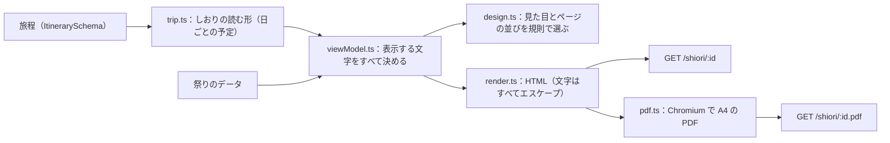

# 旅のしおりの仕様

確定した旅程を、A4 の「旅のしおり」にして渡します。画面で開く HTML（`GET /shiori/:id`）と、印刷や保存に使う PDF（`GET /shiori/:id.pdf`）は、同じテンプレートから作ります。しおりは、旅の前に3つの壁を取り除く最後のひと押しです。

| 壁   | しおりでしていること                                                                                       |
| ---- | ---------------------------------------------------------------------------------------------------------- |
| 情報 | 祭りの見どころ・日時・場所・アクセスと、使った出典（URL を文字で）を、紙の上で読める                       |
| 作法 | 「はじめての方へ」で、祭りの側からのお願いと作法を日本語と英語で出す。分からない項目は「分からない」と書く |
| 計画 | 日ごとの時刻の流れ・移動の目安・泊まる地域・雨の日の案と、持ち物のチェックリスト                           |

コードは `apps/server/src/shiori/`、素材は `assets/shiori/` にあります。

## 作り方

- 旅程の型にたよるのは `trip.ts` の1か所だけです。しおりは「日ごとの予定（`days`）と、その夜に泊まる地域（`stay`）」の形で読みます
- 表示する文字は view-model（`viewModel.ts`）ですべて決めます。テンプレートは view-model を並べるだけで、モデルに HTML や CSS を書かせません
- 祭りや店の名前・時刻・作法は、旅程と祭りのデータにあるものだけを使います。分からない項目は「分からない」（英語は Unknown）と出し、推測で埋めません
- 持ち物の「いつもの持ち物」・季節・泊まり・子ども連れの項目は、祭りの事実ではない一般の目安として、コードの決まった文で出します

## 見た目の選び方

テンプレートは、コードの決まった規則で選びます（`design.ts`）。

| 何から決めるか                     | 決まること                                                                       |
| ---------------------------------- | -------------------------------------------------------------------------------- |
| 主役の祭りの種類（`category`）     | 表紙の絵（花火・山車・神輿・踊り・火祭り・灯籠・芸能・神事・市・その他の10種類） |
| 主役の祭りの日の季節               | 色と、表紙の飾り（春は桜、夏は波とうちわ、秋はもみじ、冬は雪）                   |
| 夜に見る祭り（花火・灯籠・火祭り） | 夜空の表紙                                                                       |
| 日数と1日の長さ                    | 半日のお出かけ（日帰りで6時間以内）・日帰り・泊まりの旅（下の「ページの並び」）  |
| 子ども連れ                         | 持ち物に子どもの分を足し、スタンプ帳に絵を描く枠を出す                           |
| シニアと一緒                       | 文字をひとまわり大きくする                                                       |

## ページの並び

日帰りや半日のお出かけは薄く、泊まりの旅は日ごとにページが増えます。最大は6泊7日です。

| 旅の長さ       | ページ                                                                                                                                        | 例（架空の旅）      |
| -------------- | --------------------------------------------------------------------------------------------------------------------------------------------- | ------------------- |
| 半日のお出かけ | 表紙（見どころつき）・当日の流れ・はじめての方へ・持ち物（スタンプと出典つき）                                                                | 4ページ             |
| 日帰り         | 表紙・祭りの紹介・当日の流れ・はじめての方へ・持ち物・スタンプ帳（メモつき）・出典                                                            | 7ページ             |
| 泊まりの旅     | 表紙・（3日以上は旅の全体）・祭りの紹介（祭りごと）・日ごとの流れ（日ごと、メモ欄つき）・はじめての方へ（祭りごと）・持ち物・スタンプ帳・出典 | 1泊 8・6泊 16ページ |

| ページ         | 中身                                                                                                                         |
| -------------- | ---------------------------------------------------------------------------------------------------------------------------- |
| 表紙           | 旅の名前、旅の長さ、日にち、同行者、出発地、主役の祭り、天気、公式の情報で開催を確かめた印、旅人とコンシェルジュ             |
| 旅の全体       | 日ごとの日付・いちばんの予定・泊まる地域、雨の日・中止のときの案                                                             |
| 祭りの紹介     | 名前（日本語と英語）、種類・規模・場所、いつ・どこで、見どころ3つまで、小話2つまで、その土地の味、アクセス                   |
| 日ごとの流れ   | 天気、出発、時刻つきの予定（種類・名前・理由・移動の目安・営業時間・費用）、帰り、今夜泊まる地域、雨の日の案、メモ欄         |
| はじめての方へ | 祭りの側からのお願い、見学か参加か・申し込み・ルールとマナー・服装・持ち物・危険度・写真（日本語と英語）、交通規制などの注意 |
| 持ち物         | 祭りのデータの持ち物と服装、旅程のメモ、いつもの持ち物、泊まりの分、子どもの分（チェックボックス）                           |
| スタンプ帳     | 日ごとと祭りごとのスタンプの枠（9つまで）                                                                                    |
| 出典           | 使った出典の URL（文字）、確認した日、確度。「出かける前と当日の朝に、公式の情報で開催を確かめてください」の一文             |

泊まる地域は地域の名前とメモだけを出し、宿の名前は出しません（「宿の名前と予約は、ご自身で確かめてください」と添えます）。

## 素材とフォント

| 場所                   | 中身                                                                                                              |
| ---------------------- | ----------------------------------------------------------------------------------------------------------------- |
| `assets/shiori/svg/`   | 表紙の絵（`motif-*`）、季節の飾り（`season-*`）、アイコン（`icon-*`）、枠や飾り（`deco-*`）。すべて手で書いた SVG |
| `assets/shiori/staff/` | スタッフと旅人の静止画（透過の WebP）。`assets/3d` の Blender のスクリプトで書き出す（`--target stills`）         |
| `assets/shiori/fonts/` | Zen Maru Gothic（Medium・Black、WOFF2）と、そのライセンス（SIL Open Font License 1.1）                            |

- SVG は1つの `<symbol>` の束にしてページに埋め込みます。スクリプト・外への参照・`foreignObject` などを持つ SVG は読み込みません
- フォントと静止画は `GET /shiori/assets/*` から配ります。決まった一覧にあるファイルだけを返します
- 色はすべて、白い紙の上で読める濃さにします（本文は 10.5pt 以上）。情報は文字で伝え、絵だけに頼りません

## PDF にする

- サーバーで、HTML を Playwright（`playwright-core`）の Chromium で A4 の PDF にします
- 描くときは外へのリクエストを一切させません。ページは架空のオリジンで開き、ページと素材は手元から返し、それ以外のリクエストはすべて止めます。スクリプトは動かしません
- 作った PDF は、旅程の id・版・HTML の中身のハッシュごとにとっておきます（合計の大きさで上限を置き、古く使ったものから消す）。同じものを作っている途中なら、その結果を分け合います
- 同時に作る数と、空きを待たせる数と、1つを作る時間に上限を置きます。超えたときは 503（`upstream_unavailable`、retryable）と `Retry-After` を返します

| 環境変数                         | 既定                         | 中身                          |
| -------------------------------- | ---------------------------- | ----------------------------- |
| `MATSURI_SHIORI_PDF_CONCURRENCY` | 2                            | 同時に作る数                  |
| `MATSURI_SHIORI_PDF_QUEUE`       | 6                            | 空きを待たせる数              |
| `MATSURI_SHIORI_PDF_TIMEOUT_MS`  | 30000                        | 1つを作る時間の上限           |
| `MATSURI_SHIORI_PDF_CACHE_MB`    | 64                           | とっておく PDF の合計の大きさ |
| `MATSURI_SHIORI_CHROMIUM_PATH`   | （Playwright が入れたもの）  | Chromium の実行ファイル       |
| `MATSURI_SHIORI_ASSETS_DIR`      | リポジトリの `assets/shiori` | 素材の置き場所                |

## 安全

- 旅程・祭りのデータ・モデルの文章は、信用しない入力として扱い、すべてエスケープして文字として出します
- HTML の `Content-Security-Policy` は、このサーバーのフォントと画像だけを許し、スクリプトは許しません
- しおりは、公式の情報で開催予定を確かめた旅程だけに出します（確認前は 409、ない旅程は 404）
