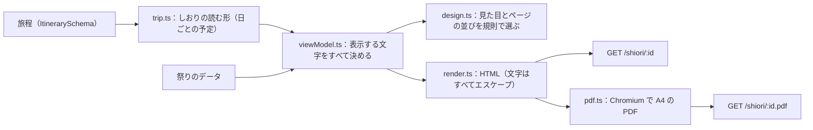

# 旅のしおりの仕様

確定した旅程を、A4 の「旅のしおり」にして渡します。画面で開く HTML（`GET /shiori/:id`）と、印刷や保存に使う PDF（`GET /shiori/:id.pdf`）は、同じテンプレートから作ります。しおりは、旅の前に3つの壁を取り除く最後のひと押しです。

| 壁   | しおりでしていること                                                                                       |
| ---- | ---------------------------------------------------------------------------------------------------------- |
| 情報 | 祭りの見どころ・日時・場所・アクセスと、使った出典（URL を文字で）を、紙の上で読める                       |
| 作法 | 「はじめての方へ」で、祭りの側からのお願いと作法を日本語と英語で出す。分からない項目は「分からない」と書く |
| 計画 | 日ごとの時刻の流れ・移動の目安・泊まる地域・雨の日の案と、持ち物のチェックリスト                           |

コードは `apps/server/src/shiori/`、素材は `assets/shiori/` にあります。

## 作り方

- 旅程の型にたよるのは `trip.ts` の1か所だけです。しおりは「日ごとの予定（`days`）と、その夜に泊まる地域（`stay`）」の形で読みます
- 表示する文字は view-model（`viewModel.ts`）ですべて決めます。テンプレートは view-model を並べるだけで、モデルに HTML や CSS を書かせません
- 祭りや店の名前・時刻・作法は、旅程と祭りのデータにあるものだけを使います。分からない項目は「分からない」（英語は Unknown）と出し、推測で埋めません
- 持ち物の「いつもの持ち物」・季節・泊まり・子ども連れの項目は、祭りの事実ではない一般の目安として、コードの決まった文で出します

## 見た目の選び方

テンプレートは、コードの決まった規則で選びます（`design.ts`）。

| 何から決めるか                     | 決まること                                                                                                                           |
| ---------------------------------- | ------------------------------------------------------------------------------------------------------------------------------------ |
| 主役の祭りの種類（`category`）     | 表紙の絵（花火・山車・神輿・踊り・火祭り・灯籠・芸能・神事・市・その他の10種類）                                                     |
| 主役の祭りの日の季節               | 色と、表紙の飾り（春は桜、夏は波とうちわ、秋はもみじ、冬は雪）                                                                       |
| 夜に見る祭り（花火・灯籠・火祭り） | 表紙の風景の空を夜空にする（昼の祭りは明るい空）                                                                                     |
| 日数と1日の長さ                    | 半日のお出かけ（日帰りで6時間以内）・日帰り・泊まりの旅（下の「ページの並び」）                                                      |
| 子ども連れ                         | 持ち物に子どもの分を足し、スタンプ帳に絵を描く枠を出す                                                                               |
| シニアと一緒                       | 文字をひとまわり大きくする                                                                                                           |
| その日に祭りがあるか               | 祭りの日は旗飾りと祭りの絵のある見た目、祭りのない日（めぐる日・移動の日・のんびりの日）は落ち着いた見た目にし、出すスタッフも変える |

## 店のしおりとしての見た目

しおりは、店「たびや」のスタッフが作って渡す、祭りに行く楽しみがふくらむ冊子として描きます。

- どのページも和紙の色の紙に、紺の二重の枠と四隅の青海波を描く
- 表紙は、店の紋と「たびや 旅のしおり」の札、旅の名前、提灯の房と季節の飾り、町と山と川の風景（空に祭りの種類の絵）、日にち・だれと・天気・出発の横並び、「きょうの主役」の札、見どころと祭りの小話、旅人のペンギンとコンシェルジュのひよこ
- 各ページの見出しは、丸い絵の印（祭りの紹介は提灯、はじめての方へは鳥居、持ち物は巾着、祭りの日は祭りの種類の絵）つきの紺の帯の札にし、上に店の札（紋と「たびや」）を付け、そのページの担当のスタッフの絵を置く
- 1日の流れは、すごろくのように「ふりだし」から「あがり」まで、番号つきのマスを道でつなぐ。マスの色と絵の印は予定の種類（移動・食事・祭り・休憩・見る）で、種類は文字でも書く
- 見どころには提灯、土地の味には団子、祭りの方からのお願いには鳥居の小さな絵を付け、スタッフの顔の絵つきのひとことを添える。持ち物は、まとまりごとに印を付ける
- スタッフのひとことは、顔の絵（`assets/shiori/staff/face_*.webp`）つきの吹き出しにする。画面の会話の窓と同じ絵なので、店で話したスタッフと同じ顔になる
- スタンプ帳には、店のスタンプ（紋と「たびや 旅の相談所」）を押しておく
- 裏表紙は、店の札、「いってらっしゃい！ よい旅を。」、スタッフ、旅の名前と日にち、店の印と開催を確かめるお願い、冊子の作り方
- 絵はすべて、このリポジトリのために手で描いた SVG と、`assets/3d` から書き出したスタッフの静止画だけを使う。写真や、権利の分からない絵は使わない。絵はすべて飾りで、同じ情報を文字でも書く

## 動き

画面で見るときだけ、CSS で動きを付けます。スクリプトは使いません。

| 場所         | 動き                                                           |
| ------------ | -------------------------------------------------------------- |
| 表紙         | 提灯が風で揺れ、ひよこが手を振り、開催を確かめた印が押される   |
| 各ページ     | 左の綴じ目を軸に、ページがめくれて開く（スクロールに合わせる） |
| 吹き出し     | ふくらんで出てくる                                             |
| 旅の全体     | 道のりの線が伸び、止まる場所が順に置かれる                     |
| 日ごとの流れ | 時刻の線が上から伸びる                                         |
| スタンプ帳   | 店のスタンプが押され、スタンプの枠が順に出る                   |

- 動きは `@media screen and (prefers-reduced-motion: no-preference)` の中だけに書きます。印刷・PDF・動きを減らす設定では動かず、動きが終わったあとの姿（最後の状態）で描きます
- 一度だけの動きは最後の姿が止まった姿と同じになり、くり返す動きは止まった姿から始まって止まった姿に戻ります。どこで止まっても文字は読めます
- 作り方と確かめ方は、開発用のスキル `.claude/skills/shiori/SKILL.md` にまとめてあります

## 画面から PDF を保存する

公式の情報で開催予定を確かめた旅程では、画面のしおり（`ShioriPage`）に「PDF で保存」を出します。共有の URL に `.pdf` を付けた `GET /shiori/:id.pdf` から、同じテンプレートの A4 の PDF を受け取ります。

## ページの並び

日帰りや半日のお出かけは薄く、泊まりの旅は日ごとにページが増えます。最大は6泊7日です。長い旅では祭りは旅の中の目的の1つで、祭りのない日も同じように1ページずつ作ります。

印刷して冊子にできるよう、表紙で始めて裏表紙で終え、ページの数を4の倍数にそろえます。足りない分は、裏表紙の前に「旅の思い出」のページ（写真をはる枠・絵を描く枠・メモ）を入れます。A4 の両面で印刷し、プリンターの「小冊子」を選ぶと、2つ折りの A5 の冊子になります（この作り方は裏表紙にも書きます）。

| 旅の長さ       | ページ                                                                                                                                                                               | 例（架空の旅）       |
| -------------- | ------------------------------------------------------------------------------------------------------------------------------------------------------------------------------------ | -------------------- |
| 半日のお出かけ | 表紙（見どころつき）・当日の流れ・はじめての方へ・持ち物（スタンプと出典と店の印つき。裏表紙を兼ねる）                                                                               | 4ページ              |
| 日帰り         | 表紙・祭りの紹介・当日の流れ・はじめての方へ・持ち物・スタンプ帳（メモつき）・出典・裏表紙                                                                                           | 8ページ              |
| 泊まりの旅     | 表紙・旅の全体（旅のかたちの図）・祭りの紹介（祭りごと）・日ごとの流れ（日ごと、メモ欄つき）・はじめての方へ（祭りごと）・持ち物・スタンプ帳・出典・旅の思い出（足りない分）・裏表紙 | 1泊 12・6泊 20ページ |

| ページ         | 中身                                                                                                                                                                                  |
| -------------- | ------------------------------------------------------------------------------------------------------------------------------------------------------------------------------------- |
| 表紙           | 旅の名前、旅の長さ、日にち、同行者、出発地、予算（聞き取ったときだけ。1人あたりか全員でかと、換算したもう一方）、主役の祭り、天気、公式の情報で開催を確かめた印、旅人とコンシェルジュ |
| 旅の全体       | 旅のかたちの図（下の節）、旅のペースと祭りのほかの楽しみ、日ごとの日付・いちばんの予定・泊まる地域                                                                                    |
| 祭りの紹介     | 名前（日本語と英語）、種類・規模・場所、いつ・どこで、見どころ3つまで、小話2つまで、その土地の味、アクセス                                                                            |
| 日ごとの流れ   | 天気、出発、時刻つきの予定（種類・名前・理由・移動の目安・営業時間・費用）、帰り、今夜泊まる地域、雨の日の案（主役の祭りの日）、メモ欄（紙面が残る日だけ）                            |
| はじめての方へ | 祭りの側からのお願い、見学か参加か・申し込み・ルールとマナー・服装・持ち物・危険度・写真（日本語と英語）、交通規制などの注意                                                          |
| 持ち物         | 祭りのデータの持ち物と服装、旅程のメモ、いつもの持ち物、泊まりの分、子どもの分（チェックボックス）                                                                                    |
| スタンプ帳     | 日ごとと祭りごとのスタンプの枠（9つまで）                                                                                                                                             |
| 出典           | 使った出典の URL（文字）、確認した日、確度。「出かける前と当日の朝に、公式の情報で開催を確かめてください」の一文                                                                      |
| 旅の思い出     | 写真をはる枠、絵を描く枠、思い出のメモ（冊子のページ数をそろえるため）                                                                                                                |
| 裏表紙         | 店の札、旅の名前と日にち、店の印と開催を確かめるお願い、冊子の作り方                                                                                                                  |

## 旅のかたちの図

泊まりの旅では、表紙の次のページ（旅の全体）に、どこを回るかが分かる図を入れます。日帰りには出しません。外の地図の画像は使わず、点と線をコードで描きます（`route.ts`）。

- 点は、出発地・泊まる地域（続けて同じ地域に泊まる夜は1つにまとめ、泊数を添える）・旅の終わりの場所。祭りの日がある地域には祭りの印を付ける
- 旅のかたち（`stay` ずっと一か所・`loop` 地域を巡る・`via` 目的地へ向かう途中で祭りに寄る）は、相談で聞いたものがあればそれを使い、なければ泊まる地域と終わりの場所から決める（地域が1つなら `stay`、出発地に戻るなら `loop`、戻らなければ `via`）
- `loop` は出発地を兼ねた点から楕円の上を回り、`stay` と `via` は左の出発から右の終わりへ波の上に並べる
- 旅のペースと祭りのほかに楽しみたいこと（温泉・食・自然・街歩き・歴史・買い物）は、相談で聞いたものだけを図の上に出す

泊まる地域は地域の名前とメモだけを出し、宿の名前は出しません（「宿の名前と予約は、ご自身で確かめてください」と添えます）。

## 素材とフォント

| 場所                   | 中身                                                                                                                                                                      |
| ---------------------- | ------------------------------------------------------------------------------------------------------------------------------------------------------------------------- |
| `assets/shiori/svg/`   | 表紙の絵（`motif-*`）、季節の飾り（`season-*`）、町の風景（`scene-town`）、見出しの小さな絵（`spot-*`）、アイコン（`icon-*`）、枠や飾り（`deco-*`）。すべて手で書いた SVG |
| `assets/shiori/staff/` | スタッフと旅人の静止画と顔の絵（透過の WebP）。`assets/3d` の Blender のスクリプトで書き出す（`--target stills`）                                                         |
| `assets/shiori/fonts/` | Zen Maru Gothic（Medium・Black、WOFF2）と、そのライセンス（SIL Open Font License 1.1）                                                                                    |

- SVG は1つの `<symbol>` の束にしてページに埋め込みます。スクリプト・外への参照・`foreignObject` などを持つ SVG は読み込みません
- フォントと静止画は `GET /shiori/assets/*` から配ります。決まった一覧にあるファイルだけを返します
- 色はすべて、白い紙の上で読める濃さにします（本文は 10.5pt 以上）。情報は文字で伝え、絵だけに頼りません

## PDF にする

- サーバーで、HTML を Playwright（`playwright-core`）の Chromium で A4 の PDF にします
- 描くときは外へのリクエストを一切させません。ページは架空のオリジンで開き、ページと素材は手元から返し、それ以外のリクエストはすべて止めます。スクリプトは動かしません
- 作った PDF は、旅程の id・版・HTML の中身のハッシュごとにとっておきます（合計の大きさで上限を置き、古く使ったものから消す）。同じものを作っている途中なら、その結果を分け合います
- 同時に作る数と、空きを待たせる数と、1つを作る時間に上限を置きます。超えたときは 503（`upstream_unavailable`、retryable）と `Retry-After` を返します

| 環境変数                         | 既定                         | 中身                          |
| -------------------------------- | ---------------------------- | ----------------------------- |
| `MATSURI_SHIORI_PDF_CONCURRENCY` | 2                            | 同時に作る数                  |
| `MATSURI_SHIORI_PDF_QUEUE`       | 6                            | 空きを待たせる数              |
| `MATSURI_SHIORI_PDF_TIMEOUT_MS`  | 30000                        | 1つを作る時間の上限           |
| `MATSURI_SHIORI_PDF_CACHE_MB`    | 64                           | とっておく PDF の合計の大きさ |
| `MATSURI_SHIORI_CHROMIUM_PATH`   | （Playwright が入れたもの）  | Chromium の実行ファイル       |
| `MATSURI_SHIORI_ASSETS_DIR`      | リポジトリの `assets/shiori` | 素材の置き場所                |

## 安全

- 旅程・祭りのデータ・モデルの文章は、信用しない入力として扱い、すべてエスケープして文字として出します
- HTML の `Content-Security-Policy` は、このサーバーのフォントと画像だけを許し、スクリプトは許しません
- しおりは、公式の情報で開催予定を確かめた旅程と、要事前確認（`needs_check`。公式以外の情報源や公式の例年の日程で確かめた）の旅程に出します。要事前確認の旅程は、表紙に「要事前確認：開催は公式以外の情報源などで確かめています。出発の前に、主催者の案内で開催を確かめてください」を必ず出します（それ以外の旅程は 409、ない旅程は 404）
